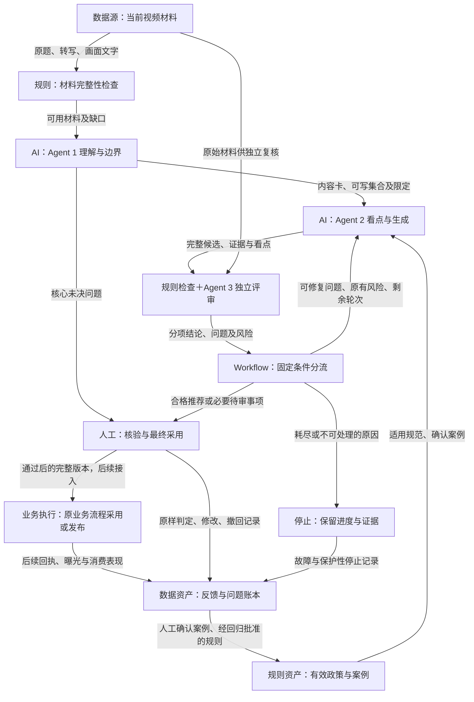

# 短视频推荐文案质量优化 Agent｜产品设计与验证方案

> **业务规模口径更新：**业务方每天需要撰写标题的视频约 3～4 万条。本文保留历史草稿，文中 700～800 万、560～640 万及相关规模、审核工时与成本推算均为旧口径，不能作为当前结论；须按新口径重新核算。此前 45 秒／条也已由约 30 秒／条的估计替代，实际平均值仍待测量。

> 版本：v0.4 初稿（纠正规模单位与初期适用范围）  
> 读者：产品经理、内容运营、质量审核及项目协作人员  
> 定位：确定产品要解决什么问题、三个 Agent 怎样协作、怎样验收、怎样利用 Bad Case 改进。本文不是当前版本的成绩单，也不替代具体实验审批。

## 阅读说明：目标、缺失信息与验收结果怎么区分

- **【正式目标】**：本初稿采用的产品目标，作为后续设计和验收依据；不代表已经达成。
- **【实测】**：有明确批次、原始记录与人工判定支持的观察，必须注明范围。
- **【测算】**：由实测或假设参数计算而来，须写清公式、输入来源和适用条件，不包装成上线结果。
- **【上线后待验证】**：需要真实业务接入及对照才能判断的经营或消费效果。
- **【业务方提供】**：用户确认的业务背景与口径，区别于本项目新版本实测；例如全量日700～800万条视频、初期内容适用比例约80%、原人工审核约45秒／条。
- **【背景待补】**：需要业务方提供、才能算清问题规模或投入产出的背景信息。
- **【待验收】**：需要在冻结版本、固定样本和明确口径下测得的结果；没有证据时不填数，不将其解释为“正在运行”。
- **【已有机制】**：项目已有相关实现或流程，但是否达到目标仍需验收。
- **【后续建设】**：本阶段之外的能力，不写成当前已接通。
- **【历史诊断】**：旧版本、旧批次的观察，只用于解释为什么这样设计，不代表当前效果。

**文档依据。** 本文以[立项文案](<project-initiation-original.md>)为业务主线，参考[懂车帝产品文档](<_ref/懂车帝复杂 agent 产品.md>)的“目标—分模块验收—效果验证—Bad Case复盘”结构，并参考[信贷协同 Agent 文档](<_ref/agent7号(1).pdf>)第1—4页的人机分工、第5—8页的问题定义、回收和修复闭环。两份参考的行业数据、案例数量和业务成绩均不迁移到本项目。另按用户提供的《Agent文档》学习资料补充五层价值推导、五种能力类型、服务路径五步法、Harness六问、流出层级与影响分级、结果统计和面试表达。资料中的80%覆盖率、3—4小时、0.03元等是行业示例，不能作为本项目实测或自动化比例。

---

## 1. 产品一句话定位

这是一套面向短视频推荐文案生产与审核场景的质量优化 Agent，通过内容理解、多候选生成、独立质量评审、反馈重写与历史案例复用，提高合格文案的产出率，减少人工筛选和问题定位成本。

它不只是“帮人写三条标题”，而是回答三个问题：**视频真正值得表达什么、标题能不能这样写、写得不好时怎样有依据地修好。**

本阶段产品以人工辅助为定位：系统给出推荐标题、其他合格候选、判断理由及必要风险，人工决定是否采用。线上发布和推荐效果验证单独推进。

## 2. 项目背景与目标用户

### 2.1 目标用户及工作场景

| 用户 | 主要任务 | 当前困难 | 期望获得的帮助 |
|---|---|---|---|
| 文案生产人员 | 批量生成视频推荐标题 | 跨垂类内容复杂，低质输出直接作废造成供给损失 | 得到有事实支撑、角度明确的候选，并自动修复可修复问题 |
| 质量审核人员 | 判断标题能否使用，指出问题 | 需要逐条读材料、识别事实风险和表达缺陷 | 先看到推荐、风险及证据，减少无效筛选 |
| 规则运营人员 | 抽检、分析问题、维护规范 | 问题散落，重复归因，个案容易变成过度规则 | 看到同类问题、影响范围与可验证修复建议 |
| 产品负责人 | 判断系统是否值得投入和扩大使用 | “模型说通过”和“业务真的可用”混在一起 | 用固定口径比较质量、安全、效率与成本 |

### 2.2 原有链路与问题

**原有生产链路（来自立项描述）：**

视频信息提取 → 规则约束 → 模型生成标题 → 模型基础审核 → 人工质量审核 → 通过或驳回。

未通过的标题直接作废，缺少根据具体问题进行自动修复的环节。规则更新则依赖人工抽样、问题分类、归因、提炼规则、测试和修改提示词。

这带来四类成本：

1. **供给损失。** 一个表达瑕疵也可能导致整条任务没有合格标题，原本可修复的内容被直接放弃。
2. **判断成本。** 人工既要筛选候选，也要重新理解视频、核对事实、发现标题承诺与实际内容是否一致。
3. **重复错误。** 某条视频已经暴露的问题，换个题材仍然出现，过去的判断未转化为可复用经验。
4. **维护负担。** 为处理一个案例反复叠加通用规则，可能解决旧问题，却误伤其他类型的正常表达。

**【业务方提供】** 全量基础规模每天约700～800万条视频，其中约80%符合项目初期标题撰写要求；因此初期适用范围【测算】为每天约560～640万条视频。80%是内容适用比例，不是模型通过率、文案可用率或人工审核覆盖率。上述是业务范围，不代表本地原型已按该规模运行，也不是实际进入人工复核的文案条数。原人工审核单条文案控制在约45秒，属于业务操作口径，尚不等同于有抽样记录支持的平均值或分位值。原链路审核不通过即作废，没有逐条人工返工流程；Bad Case整理与规则更新耗时目前不可量化，不纳入量化节省承诺。

质量验证有两层：模型评审通过后由人工复核其通过率；全部生成文案中可用文案的占比。业务收益继续追踪文案对应视频进入精排的比例和后续曝光点击表现。具体历史比例、周期和统计记录仍【背景待补】。本项目现有公开视频实验不等同于已接入真实生产业务。

### 2.3 什么叫一条“可用文案”

本项目把可用定义为：**事实与内容承诺正确、没有必须拦截的政策问题、满足展示约束、能够独立理解、具有明确的信息价值和观看理由，人工无需实质修改即可采用。**

人工判定沿用三档：

- **可用：** 原始完整标题可直接采用。
- **勉强通过：** 大体可理解，但存在明确质量瑕疵，仍需修改或降低使用预期；不计入严格可用。
- **不可用：** 存在事实、核心看点、政策或明显表达问题，不能作为正常交付。

“编辑后通过”需同时保存原始标题与最终版本，不能把人工修好的标题计成模型原始产出成功。轻微与实质修改的划分按含义是否变化，而不是只看改动字数。

### 2.4 关键背景信息缺口

| 编号 | 需要的信息 | 用途 | 未补齐前的处理 |
|---|---|---|---|
| B01 | 全量日700～800万条视频，初期适用约80%，即560～640万条／日【业务方提供＋测算】；真实策略覆盖、候选数与人审抽样量待补 | 区分基础总量、适用范围、策略实际覆盖与人审工作量 | 不把适用范围当已经处理量，不将其全乘45秒推算人力 |
| B02 | 已确认人审通过率、全量文案可用率的方向；历史值、原始分母与周期待补 | 核实原稿52%、84%、70%分别对应什么 | 不把文案级比例当任务级成功率；未评模型拦截项时不能算召回率 |
| B03 | 人审约45秒／条【业务方提供】；审核条数和人力单价待补；无逐条返工，规则维护暂不可量化 | 衡量审核效率与单位合格供给成本 | 不要求提供不存在的返工耗时，不计算规则维护节省 |
| B04 | 代表性成功与失败视频、当前审核规范 | 明确“可用”的真实边界 | 以已确认规则做离线验收，争议交人工 |
| B05 | 模型与核查服务价格、单批预算上限 | 判断复杂链路是否值得使用 | 记录调用量和耗时，金额待价格表确认 |
| B06 | 已确认关注进入精排比例及曝光点击；去重对象、分母、窗口、平台与对照待补 | 制定真实业务收益与上线方案 | 不把进入精排率和CTR合为一项，不预承诺提升 |

这些信息可由业务方分批提供，不影响先完成产品设计；但会影响投入产出、业务基线和上线章节的定稿。

## 3. 产品目标与范围

### 3.1 三层目标

**质量目标：** 首轮产生更多合格候选，评审能识别不合格标题，又不过度拦截正确表达；重写修复具体问题，而不是换成一个更容易过审的边角事实。

**效率目标：** 人工少花时间筛选、查证和定位问题；单位合格交付的总成本下降，不能只减少模型费用却增加人工负担。

**业务目标：** 提高有效标题供给，减少事实错误、内容不匹配和过度承诺。后续具备真实流量条件后，验证对点击与消费质量的净影响。

### 3.2 从“替人做了什么”到“业务得到什么”

能力覆盖率是手段，不是成绩。不能把“生成、评审、重写都接通了”直接翻译成“节省80%人力”。本项目按五层价值链逐级验证：

| 层级 | 本项目的具体内容 | 数据与计算方式 | 当前性质 |
|---|---|---|---|
| 1 动作替代 | 先整理材料、提出候选、筛选并定位缺陷 | 已辅助的操作次数／适用操作次数；关键判断仍人工确认 | 【已有机制】，覆盖率【待验收】 |
| 2 效率结果 | 人工减少审核中的判断与查证用时 | 同等质量和审核范围下，单条审核用时较45秒参照下降≥30%；同时报告每任务总人审用时 | 【业务方提供基线／正式目标待验收】 |
| 3 质量结果 | 更多首轮合格供给、更高文案可用率，更少人审驳回 | 首轮成功率≥78%，放行准确率≥95%，合格召回率≥90%；另报修改率和误拦 | 【正式目标／待验收】 |
| 4 业务结果 | 相同审核资源获得更多可用供给，更多供给进入精排并获得有效曝光点击 | 每人工小时可用供给、进入精排比例、曝光量、点击量与CTR；记录入队到确认时长，不计算不存在的返工周期 | 产能【测算待输入】，下游【上线后待验证】 |
| 5 价值定性 | 对内容消费者：减少预期落差；对一线：减少重复判断；对组织：质量标准可复用、扩量不必同比增人 | 分别用消费护栏、人工用时、质量与成本证据支持 | 产品价值主张，不写成已达成结论 |

**本项目的换算表（没有基线前不填结果）：**

- 原审核工时【条件测算】＝原实际人审文案条数A₀×45秒÷3600；新审核工时＝新实际人审条数A₁×新每条实测秒数t₁÷3600。两者按相同视频任务范围比较；新方案更多候选可能增加A₁，不能只看单条更快。
- 初期内容适用范围【测算】＝700～800万条／日×80%＝560～640万条／日。实际进入新策略的量还要乘以策略覆盖比例，实际人审量由抽样和风险分流决定；这些比例未提供，不据此推算审核工时。
- 撤回旧版按700～800条计算的“8.75～10小时／日、节省2.625～3小时／日”情景，因规模单位错误不再使用。单条审核下降30%的目标仍对应45秒×70%＝31.5秒；总节省必须基于实际人审条数重算。
- 实际释放工时＝可比任务范围的原总审核工时－新总审核工时；新流程人工核验和异常处理也计入。月度外推需真实人审条数、运行天数和任务结构，不能用自动化节点占比代替时间。
- 释放人力容量＝月释放工时÷每人月有效工作时长H。这里只表示容量，不直接宣称裁员或现金节省。
- 月新增严格可用交付＝相同范围月任务数N ×（新严格可用交付率p₁－原交付率p₀）。实验抽样与真实任务结构不一致时不得直接外推。
- 固定审核资源下的产能＝实际严格可用交付量÷人工总工时。不能简单用耗时下降30%推断所有环节产能同幅增加；瓶颈转移、排队和新增人工处理量要实测。
- 月净收益【测算】＝已确认可计价的审核人力节省－新增模型、核查及运维费用；与“每条可用交付综合成本下降≥20%”回扣。不得把释放工时和裁减费用重复计算。
- 端到端交付周期＝输入进入业务队列到人工最终确认的时间，和不含人工等待的模型处理耗时分别记录。原链路没有逐条返工，不能套用“减少一轮退回省几天”；新方案重写的模型耗时与等待应直接计入处理时间。

业务方已提供日任务规模和45秒审核参照；实际人审文案数、人力口径H、价格与新流程用时仍待补测。Bad Case整理和规则更新时间不量化，只记录机制和重复问题变化。进入精排率、曝光点击及观看时长没有可信离线收益换算公式，需真实下游记录与对照确认。

### 3.3 百万级业务范围与本地验证方案的边界

初期适用560～640万条／日意味着，产品面向的是大规模文案供给，而不是几百条任务的人工生产工具。适用量不等于当前策略实际覆盖量，更不等于本地原型的已实现吞吐。

- **人审不是默认全量前置。** 当前原型和离线实验保留人工确认，是质量验证方式；真实业务的抽检、风险分流与自动采用权限需单独确认。不能将每条45秒乘百万级视频数，宣称真实审核投入或节省。
- **三个Agent是职责分工，不等于每视频必跑三套完整模型调用。** 哪些样本进入完整路径、哪些可复用结果或走低成本路径，需要在不降低质量的条件下独立验证，不在本稿默认已经实现。
- **现有单任务护栏只用于离线／有限试用设计。** 24次请求与1元是防止单任务失控的上限方案，不是全量预算或合理平均成本；三候选、外部核查与重写也要结合触发比例计总账。
- **新增全量前置验收。** 基于实际覆盖比例、峰值流量、重复视频处理方式、各路径调用次数、缓存与重写触发，核算日费用、峰值处理能力、积压恢复、服务配额与风险升级量。数据未齐前均【待评估】，不能把200条质量验收通过当成百万级上线验收通过。

因此，本稿先证明质量机制和单位经济性，再决定真实覆盖与容量方案；原先“全部交人工采用”的表述只适用于当前离线验证与有限试用，不是对全量生产架构的断言。

### 3.4 本阶段做什么、不做什么

| 本阶段范围 | 本阶段不承诺 |
|---|---|
| 单视频理解、可写边界、标题生成与独立评审 | 跨视频流量分配或全局投放预算规划 |
| 首轮最多3条候选，最多额外重写2轮 | 无限制自动尝试，直到碰到一条通过 |
| 推荐1条，保留其他合格候选，人工确认 | 无人审核直接发布 |
| 人工反馈、正反案例复用、修复建议和回归 | 模型自行修改规则、源码或生产版本 |
| 离线对照、人工辅助试用方案 | 当前已经带来CTR、UCTR或观看时长提升 |

**为什么在固定流程中引入 Agent？** 理解核心看点、判断必要限定、评价内容兑现和根据反馈修改，都难以靠固定词表穷举；但长度、标注、重试次数和质量分流应交给程序。本文的 Agent 指承担一类语义判断职责的产品模块，不代表拥有自主调度和发布权限。

### 3.5 为什么不用更简单的工具，为什么现在做

| 替代方式 | 可以承担的工作 | 无法单独解决的问题 | 本项目选择 |
|---|---|---|---|
| 规则引擎与代码 | 长度、必要标注、引用合法性、费用与轮次计算 | “这句话虽然在片中出现，但是否代表主线”无法只用词表判断 | 确定部分继续用规则，不全交模型 |
| RPA／系统自动化 | 搬运素材、录入已批准标题、查询发布状态 | 无法理解原题与转写冲突，也不能判断看点 | 当前离线不需要专门RPA；未来接入优先用稳定接口，无接口才评估RPA |
| SQL／报表 | 汇总通过率、耗时、问题分布和版本对照 | 不能解释标题为何将支撑论据误作核心 | 统计交给查询与计算；语义归因仍需模型辅助及人工确认 |
| 人工或外包 | 真正看视频、判质量、处理争议 | 重复判断与知识转移有成本，但目前成本规模待补 | 保留最终确认与抽检；用实测净收益决定替代范围 |
| 单次模型直出 | 快速生成初稿，链路简单、便宜 | 缺少独立审查、约束传递和有依据的定向修复 | 作为必须比较的简单基线，不预设复杂方案一定胜出 |

需要模型的具体理由至少有三项：

1. **非结构化理解。** 同一事件分散在原题、口语转写和画面文字中，必须结合否定、指代及前后情节理解，不能只抓关键词。
2. **判断难以穷举。** “古早妆容教学”和“泛泛的详细教程”、“包装潮流”和“成本细节”都没有唯一模板；是否代表主旨需要语义判断。
3. **长尾组合。** 资讯、剧情、观点、教程的证据与表达边界不同。通过案例帮助理解适用情形，比无限添加通用禁词更有机会减少维护成本，但该净收益必须实验验证。

**为什么是现在：** 现成模型提供了中文理解、结构化输出和反馈修订的可试验基础，项目已有真实调用与人工反馈机制，因此具备验证条件；尚无证据证明某一年模型已跨越本项目可用线，更不能引用参考行业的95%准确率或0.03元成本。能力拐点以本项目三个Agent验收指标为准，成本拐点以每条严格可用交付的综合成本下降≥20%为准。目前均为【待验收】，若简单基线更好就采用简单方案。

## 4. 产品设计：三个核心 Agent

### 4.1 职责总览

| Agent | 核心任务 | 主要输出 | 不能做什么 |
|---|---|---|---|
| **Agent 1：内容理解与边界判断** | 看懂视频，区分事实、观点、推断和剧情，判断哪些内容可以写 | 内容摘要、核心信息与证据、可写/需限定/待核验/不可写清单 | 把描述当事实；用“据称”消除未解决风险；决定标题最终放行 |
| **Agent 2：看点与文案生成** | 找到核心观看价值，生成差异化标题，并按反馈定向修改 | 看点卡、最多3条候选、对应证据、修改说明 | 编造效果、偷换主旨、借用其他案例事实；给自己的标题批准 |
| **Agent 3：独立质量评审** | 从用户理解出发检查标题，识别缺陷并给出处理建议 | 质量判断、分项评分、证据理由、可修复问题与修改指导 | 修改标题；用高吸引力抵消事实问题；替代人工最终确认 |

外部事实核查作为 Agent 1 的按需辅助能力：适用于可公开核实的断言，返回支持、反驳或无法核实。没有搜到不等于事实为假，不能通过检索结果编造新的视频内容。是否启用需结合领域、调用成本和核验价值决定。

### 4.2 Agent 1：内容理解与边界判断

**输入。** 原视频标题、语音转写、画面文字、现有视频描述、领域与形态标签，以及可用素材。当前画面描述可能是模型生成，不能当成人工确认事实；图片路径也不等于系统真的看过画面。

**处理。** 先理解整片主线，再整理“谁做了什么、在什么条件下、视频真正想表达什么”。区分主旨、支撑信息和边角细节；对人物关系、数字、否定、因果、历史时间及来源冲突保留依据。

**输出。** 一张内容与边界卡，至少包括：

1. 一句话主旨及关键内容。
2. 可供标题引用的信息及原材料位置。
3. 必须保留的主体、条件、时间和来源表达。
4. 待核验、不应使用的信息及原因。
5. 材料不足时的缺口清单和处理建议。

**判断原则。** 原题是理解线索，不是事实保证；“片段出现过”不等于“它是整片重点”；上下文未解不能被下游润色解除。若没有足够材料支撑任何可兑现标题，应停止或转人工，不强行凑供给。

**场景示例（设计示例）。** 原题说“新手练三天即可改善体态”，材料只展示一组训练动作，没有三天效果证据。允许表达动作与演示，不允许承诺三天见效；若整片核心就是这一效果承诺且无法核实，需要人工确认，不能换成无关细节假装完成任务。

**验收重点。** 关键事实准确率≥95%，关键事实覆盖率≥90%，不可写信息拦截率≥95%，可写信息误拦率≤10%；高风险必过集全部正确处理。均为【正式目标／待验收】。

### 4.3 Agent 2：看点与文案生成

**输入。** Agent 1的内容与边界卡、适用业务规范，以及已确认且适用的历史案例。

**先选看点，再写标题。** 用一句话说明“用户看完真正能获得什么”。看点必须代表主线，不能因为某句话更猎奇，就把一个采访片段写成整条采访的主题。

**首轮三种表达方向。**

- **保守重述：** 在材料支持下保留原题选题，去掉夸张、歧义和不必要修饰；原题与材料冲突时不能强行保留。
- **核心概括：** 直接表达视频主旨和明确观看价值。
- **核心钩子：** 在同一主旨下用方法价值、真实反差或关键比较形成吸引力。

这三条应是同一视频核心内容的不同写法，而不是三个互不相关的片段。证据、标注和长度无法同时满足时，可以少产出并说明原因，不能为凑满三条违规。

**重写方式。** 根据评审指出的问题，保留正确内容，针对性修复。允许调整同一主旨下的看点表达；不允许通过换成边角事实来绕过主旨要求。核心事实未决不进入普通表达重写，重新核验或转人工。

**示例（设计示例）。** 视频教一种具体妆容，“超详细化妆教程”虽然不一定事实错误，但丢失了用户真正想学的妆容。修复应补回具体妆容与教学价值，而不是叠加“必看”“绝美”等词。

**验收重点。** 主看点人工接受率≥85%，首轮任务成功率≥78%，最终合格供给率≥85%，重写挽救率≥35%。均为【正式目标／待验收】。

### 4.4 Agent 3：独立质量评审

**输入。** 用户实际会看到的完整标题、原始材料、边界卡及本次适用规范。生成者的自我评价不作为通过依据。即使共用同一模型，也应独立执行评审；“独立”指职责和输入隔离，不声称两个模型错误互不相关。

**第一步先问：用户只看标题，会以为什么？** 再判断材料是否支持这一理解，避免只核对个别词和引用编号。

评审分为两层：

| 层级 | 检查内容 | 处理原则 |
|---|---|---|
| 事实底线 | 主体、数字、来源、时间、限定、断言是否准确 | 有关键问题不能通过 |
| 政策底线 | 是否符合已确认业务政策 | 缺失或冲突转人工，不能自行发明禁令 |
| 内容兑现 | 视频是否兑现标题承诺，标题是否仍代表核心看点 | 不能用“这句话确实出现过”代替核心匹配 |
| 展示底线 | 完整标题长度、必要标注、格式 | 由程序执行，模型不能覆盖 |
| 清晰度 | 不看额外解释能否读懂 | 1分明显不足，2分合格，3分优秀 |
| 信息价值 | 是否具体、有辨识度、与内容相关 | 同上 |
| 观看吸引力 | 是否存在真实、可信的观看理由 | 同上，不给夸张和未兑现承诺加分 |

**通过条件。** 底线全部满足，三个质量维度分别≥2分；仅在合格候选内部比较总分。总分不是万能门槛，事实错误不能靠其他项高分抵消。评分规则作为本版产品方案，仍需用人工样例校准。

**输出。** 是否可推荐、具体问题、材料依据、是否可修复、应该回到哪个职责环节、修改时必须保留什么。问题定位是可审核判断，不冒充已证实根因。

**验收重点。** 放行准确率≥95%，合格召回率≥90%，不合格文案误放率≤5%，问题定位人工认可率≥85%。均为【正式目标／待验收】。

### 4.5 人工与程序的分工

程序负责长度、必要标注、合法引用、风险状态继承、候选排序和轮次上限；案例检索和存储也不另设Agent。

人工负责争议事实、政策边界、最终采用、案例确认及生产规则批准。确认使用不等于确认所有上游归因；运营可指出“标题偏题”，不必替系统填写技术根因。

### 4.6 五种能力类型：产品名叫Agent，节点不都是真Agent

| 类型 | 适合什么 | 在本项目的位置 | 出错后怎样处理 |
|---|---|---|---|
| 规则／代码计算 | 输入逻辑确定、应有同一答案 | 字数、标注、引用范围、质量分流、费用与统计 | 修逻辑和数据校验，补测试；不能改Prompt冒充修复 |
| RPA／系统自动化 | 无需判断的重复操作 | 【后续建设】批准后录入、发布和状态同步；当前本地存储为代码处理 | 查执行回执、有限重试或转人工，不能只改模型话术 |
| LLM理解与生成 | 无唯一字面答案、需语义经验判断 | 三个业务Agent内部的理解、选题、写作和评审 | 对照证据、独立评审、人工确认，确认根因后调任务与样例 |
| Workflow固定工作流 | 把上述能力按预定条件串起来 | 先理解再生成评审，按风险、质量和轮次分流 | 修流程和状态传递；异常停止，不由模型擅自跳步骤 |
| 严格意义的自主Agent | 模型自己规划步骤、选工具并改变下一步 | 本阶段不引入开放式自主调度 | 若未来引入，需另建工具权限、轨迹级评测和预算约束 |

判断顺序是：能明确计算就用规则；只是搬运就自动化；需要理解和生成才用LLM；需承担业务责任则留人工，再由Workflow串联。并非所有能写成if-else的业务都已有正确规则，也不能用模型自报置信度代替验证。

金额、预算、次数与统计均用代码计算；政策的文字理解可以模型辅助，但明确政策限制由确定性检查和人工批准兜底。本文“三Agent”是业务模块划分，技术实质仍是固定Workflow中的LLM节点，不是三个自由行动的数字员工。

## 5. 用户服务路径与异常处理

### 5.1 正常路径

输入视频材料 → Agent 1理解与边界 → Agent 2选择看点并生成 → 程序检查与Agent 3独立评审 → 推荐候选 → 人工确认 → 记录采用和反馈。

推荐页先展示：推荐标题、其他合格候选、推荐原因、必须人工确认的风险；材料证据和详细流程按需展开。未合格的诊断标题不能伪装成系统推荐。

### 5.2 质量分流规则

| 情形 | 产品处理 |
|---|---|
| 至少1条符合全部要求 | 保留所有合格候选，择优推荐1条；停止不必要的自动重写 |
| 无合格候选，但存在可修复的表达问题 | 对可修复候选定向重写，最多额外2轮，每轮重新完整评审 |
| 核心事实、主旨或政策存在未解决疑问 | 转核验或人工；不能因文案变流畅而解除 |
| 明确禁止内容，且无安全可用方案 | 驳回或停止，不循环尝试绕过政策 |
| 材料无法形成可靠看点 | 停止并说明缺口；不把正常保护性停止记成程序故障 |
| 重写耗尽仍不合格 | 停止自动生成，保留已有候选与理由供人工处理 |
| 网络或临时服务故障 | 有限重试、保留进度；不可重试故障停止并说明 |

人工驳回推荐后，优先检查其余合格候选。人工明确要求再次修改属于新的修订操作，需保留原始推荐，不改写旧评测记录；此入口的具体体验与接线为【待验收／待完善】，不默认已有自动触发。

### 5.3 反馈路径

人工判定 → 保存原始与修改后标题 → 形成正例或缺陷记录 → 人工确认适用范围 → 案例库复用；需要改规则或流程的问题另走修复、测试与发布审批。

历史事实案例只教系统“怎样核对、怎样避免错误”，不能替代当前视频证据。撤回、改判或规则过期后，旧案例应失效或重新审核。

### 5.4 先梳理业务，再标角色、泳道和数据流

本文按五步完成服务路径：①先看“准备材料→理解→写作→审核→采用→复盘”的业务主流程；②识别每节点的人机分工与输入输出；③划分数据、规则、AI、人工与数据资产五条泳道；④标明箭头传递的材料、判断、反馈与回执；⑤明确一年后沉淀哪些资产。线上未接通的箭头用“后续”标明。

下表是服务路径图的文字版，每行都说明流入什么、谁处理、流出什么以及何时等人。

| 节点与泳道 | 能力类型／处理者 | 输入 → 输出 | 常见失败与兜底 | 观察指标 |
|---|---|---|---|---|
| S01 数据接入 | 数据源＋规则代码 | 原题、转写、画面文字、素材 → 可用材料清单及缺口 | 缺文件、低质量转写：标记并补材料，不造证据 | 材料完整率、低材料任务占比 |
| S02 理解与边界 | AI层／Agent 1的LLM判断＋规则保护 | 材料包 → 内容与边界卡、待核验清单 | 主体错、来源冲突：保留不确定项；核心未解转人工 | 事实准确／覆盖、边界误拦漏拦 |
| S03 按需核查 | 外部只读搜索＋LLM辅助判断 | 可核查断言 → 来源、支持／反驳／无法核实 | 无来源、搜索失败：保留未知；不推断真假 | 来源可追溯率、核查正确率、成本 |
| S04 规则与案例 | 规则层／代码检索，不是自主Agent | 当前领域形态、规则版本和问题 → 适用规范与确认案例 | 过期、不匹配：排除；检索为空则只依正式规范 | 检索有效性、失效案例流入率 |
| S05 看点与写作 | AI层／Agent 2的LLM | 边界卡、规范、案例 → 看点卡及最多3条标题 | 偏题、编造、模板化：程序检查、独立评审；不可满足则说明 | 核心接受率、首轮供给率 |
| S06 机械检查 | 规则层／代码 | 完整标题与有效约束 → 通过或明确违规项 | 超长、漏标注、非法引用：拦截；查代码逻辑而非只改Prompt | 硬约束通过率、违规流入量 |
| S07 独立评审 | AI层／Agent 3的LLM | 原始材料、完整标题及约束 → 判断、评分、问题依据 | 漏判、误判、前后矛盾：结构校验和人工复核 | 放行准确率、召回率、问题定位认可率 |
| S08 推荐或重写 | Workflow＋规则层 | 检查与评审、风险状态、轮次 → 推荐／重写／待审／停止 | 风险聚合丢失：最终统一重查；耗尽预算停止 | 风险继承、挽救率、停止原因 |
| S09 人工卡点 | 人工层／质量审核人员 | 推荐及证据 → 原样采用／修改／勉强／驳回 | 误点或争议：撤回改判留痕；不能覆盖原始推荐 | 原样接受率、修改率、审核用时 |
| S10 采用与结果 | 【后续】业务执行人员＋接口或RPA | 批准的最终标题 → 发布回执与消费数据 | 失败、重复执行：幂等、有限重试、人工接管；未接通不写成已发布 | 执行成功／重复率、CTR、观看护栏 |
| S11 反馈与改进 | 数据资产层／存储代码＋人工确认 | 判定、修改、故障、未来回执 → 确认案例、缺陷、回归和修复批准 | 未确认根因、旧反馈污染：先调查，确认后入有效资产 | 复发率、闭环率、维护工时 |

**人机协作路径（箭头上明确流动的内容）：**

图中的回流不是“结果一回来就自动改规则”。人工判定可形成案例；系统性修复需确认、测试、批准。发布及消费回执为后续能力，不是当前已有链路。

### 5.5 跑一年后应沉淀哪些资产

| 资产 | 具体内容 | 用途与边界 |
|---|---|---|
| 版本化业务规范库 | 通用、垂类、形态和政策规则，适用条件与批准来源 | 可解释判断，不让过期规范继续生效 |
| 人工金标准与评测集 | 原始完整标题、三档判定、依据、任务版本、争议处理 | 冻结验收；训练或调优使用后不再冒充未见验证集 |
| 正反案例记忆 | 哪种场景、什么表达、为什么错、可参考的正确做法 | 跨任务避错，不把历史事实移植到新视频 |
| 缺陷与修复账本 | 根因、流出层级、影响程度、修复、批准和复发 | 对同根因持续负责，不只堆积问题条数 |
| 回归场景库 | 必过场景、原例、变体、反例与历史正确案例 | 版本升级防退化，支持撤除多余护栏 |
| 运行与成本记录 | 每步材料、调用、耗时、费用、结果、停止原因 | 回放与投入产出分析，分清判断错和执行错 |
| 【后续】采用与效果库 | 人工采用版本、发布回执、曝光及消费表现 | 只有接通后才支持业务效果归因 |

沉淀量不是越大越好。每项必须有适用范围、版本、访问权和失效管理；敏感素材不会因“积累资产”而无限保留。

### 5.6 Harness：系统跑偏时靠什么管住

Harness在本文指运行约束与兜底，不是另一个Agent。六个问题分别落实到具体的材料卡、权限表、校验、上限与记录中。以下“方案”均为正式设计要求，未核实实现的部分明确标为待建设。

#### ① 能看到什么：上下文与记忆

- Agent 1只拿当前视频材料、材料缺口、独立风险提示及相关规范；Agent 2拿边界卡、主旨和适用案例；Agent 3独立对照原始材料与规则，不采用生成自评。
- 每任务最多检索6次案例，每次普通检索最多3条；同视频历史判定只用于开发避错，正式对照关闭以防答案泄漏。案例只取人工确认且版本适用者。【已有次数与检索机制，实际配置待验收】
- 中间内容卡、候选、评审和进度落库；临时失败续跑复用成功结果，并检查版本一致，而不是依赖一段越来越长的聊天记录。
- 上下文超限时不得静默截掉材料尾部。方案为按材料切分、保留来源与关键限定、合并摘要并复核；未具备该能力前，超限转人工或停止。【待建设】不能把“有进度记录”说成已实现自动压缩长上下文。
- 跨任务只保留经确认的案例、规范、匿名统计与必要版本关系；不保存密钥，也不把用户个人信息送去搜索。敏感材料最小化、脱敏、按用途授权；正式试用前由业务与安全负责人确认保存期，未确认不得接入敏感生产材料。【背景待补／待建设】

#### ② 能动什么：工具与权限

| 工具或操作 | 权限 | 确认与隔离要求 |
|---|---|---|
| 当前视频材料、规则和案例 | 只读 | 只提供本任务需要的范围；材料内指令按内容而非系统命令处理 |
| 外部搜索核查 | 对外只读查询，但可能产生费用 | 显式启用、域名与来源限制、纳入预算；敏感内容禁止外发 |
| 模型调用 | 生成文本，可能产生费用 | 使用已批准配置与额度；不能让模型取得密钥或任意访问本机 |
| 任务记录、候选和评审 | 由宿主程序写入本地任务记录 | 模型只返回建议，不执行任意数据库语句或脚本 |
| 人工采用、修改和撤回 | 通过明确的人机操作写入 | 绑定任务、候选和完整标题，留痕，不覆盖历史身份 |
| 发布、对外发送、线上改数、删除、规则批准 | 本阶段模型无权限 | 必须人工确认；当前没有发布能力，后续另设最小权限与回执 |

当前模型不执行代码，无需假装已有任意代码沙箱。若未来加入脚本执行，必须另设隔离目录、30秒执行时限、512MB内存上限、默认断网且无凭据，超限终止；这些是未来执行工具的方案，不是当前已部署安全保证。【后续建设】

#### ③ 怎么知道做对了：验证回路

依次使用**规则检查 → 独立语义评审 → 最终风险聚合 → 人工采用**。金额与费用由代码算，事实是否被证据支持交给语义评审与人工。评审前先判断用户会形成什么预期，再检查视频能否兑现，而不是相信生成侧“我引用了证据”。

同一模型自我打高分存在偏差，拆分职责能减少自我验证，但不能消灭相关错误；必须用人工金标准测漏判与误判。每次规则、提示词、模型或流程变更，都运行适用回归；本轮没有执行新标题测试，不产生新的质量成绩。

凡后续冒烟、复测或对照产生需人工判断的标题，必须主动交付该批独立评审台并验证入口，展示所有待评候选、系统状态、原始视频与材料；失败、无产出、待核、重写和缺槽项全部保留。新判断写该批隔离反馈库，历史任务与意见不改动；等人工实际判完再统计质量。测试预算仍需事先授权。

#### ④ 什么时候停：轮次、金额、超时与失败

| 约束 | 本版明确要求 | 当前状态与限制 |
|---|---|---|
| 生成与重写 | 首轮最多3条；额外最多2轮，每轮均重新检查 | 【已有机制】实际行为待验收；不是每Agent各自2轮 |
| 输出或临时调用失败 | 同一调用最多重试1次，连续2次失败停止该节点 | 【已有重试机制】不可重试故障首个即停，不消耗剩余次数 |
| 案例与核查 | 案例检索≤6次；核查断言≤3条；均不能绕过总预算 | 【已有次数配置】不等于无限外部工具调用权 |
| 总调用与金额 | 每任务总模型请求≤24次（含失败和重试）；费用预留上限1元，批次另设批准总额 | 【待建设】1元为本版设计预算，不是实测成本或已生效限额；价格表与适用性待确认 |
| 时间 | 单次请求≤60秒，整任务180秒到时停止自动处理、保存进度并交人工 | 【待建设】当前适配器默认单请求可等待300秒；不能把体验目标误写为已有熔断 |
| 硬约束或事实问题 | 严重政策禁止、核心事实未决直接停或转人工；一般可修复问题最多2轮 | 不以输出格式合法证明事实合格 |

每个新请求之前，程序用已消耗费用＋在途预留＋本次最大费用估算检查1元额度；价格、用量或余额未知时不新发付费请求，转人工确认。费用必须包括核查与失败调用，不能只数成功响应。服务商计费延迟或不提供可靠上界时，客户端不能保证真实账单绝不超额，需配合服务端额度；在途请求尽力取消，仍可能计费。额外加预算必须人工批准，不自动拆任务绕过。

本版24次与1元仅是离线／有限试用单任务护栏方案，不是百万级全量的平均调用量、成本目标或批准预算。全量需另做覆盖、分流、单价、峰值和日预算测算；实施前按实际价格和调用结构确认能否支撑质量目标；调整需先改版本与批准预算，不能看失败结果后静默放宽。180秒内保存停止状态不算成功产出，首次技术完成率与可用交付另算。

#### ⑤ 出错怎么查：日志与可观测

每步保留任务与候选身份、材料和规则版本、输入摘要与可复核快照、调用模型／工具、参数、结果、重试、耗时、用量、费用估计、风险、分流原因和人工修改。日志不打印凭据；敏感材料在授权存储中保存引用，不复制到公开报告。

对一次失败可依次回看“看到了什么→理解了什么→允许写什么→选了哪个看点→生成什么→评审怎样判→为什么分流→人工怎样改”。重放旧响应能检查当时流程，不表示再次调用模型会得到相同输出；只有当前版本新验证才能判断修复效果。【已有快照与进度机制；完整成本账、审计权限与生产保存策略待建设】

#### ⑥ 怎样越用越好：将错误固化为环境约束

同根因第二次确认出现，就必须评估升级为规则、每次必读规范或回归测试，而不只是继续加一句提示词；不是看见相同词就固化全局禁令。确定性问题修代码，语义任务不清改任务说明或样例，检索错改案例范围，流程传递错修分流。

**已有沉淀示例。** 历史“小包装成本论据取代包装潮流主题”等问题，推动形成主旨卡、三种同主旨候选和重写主旨锁；项目已有[主旨锁测试](<../tests/test_rewrite_thesis_lock.py>)与[生成评审规范](<../agent_system/prompts.py>)。明确更换主旨标识会被检查，遗漏标识可继承；但标识相同不能证明内容没有偏题，仍需独立语义评审。这里只确认“沉淀成规范与检查”，不宣称原案例的修复效果已正式验收或线上复发已消失。

#### 模型升级后，哪些护栏可以减少

每项护栏登记目的、风险、误拦、耗时与维护成本。更强模型可优先测试减少冗余重问、重复语义检查或低风险人工复核；长度、已批准政策、预算、权限和身份校验不因模型升级而取消。

减法需做“保留／撤除该护栏”的同样本对照：高风险必过集100%通过、质量目标不退化、不合格误放率≤5%、严重漏放不增加，并降低成本或耗时，才由人工批准试用。样本不足以判断非劣时继续保留，不以“没发现事故”批准。所有改变记录护栏版本，不让系统只做加法。

## 6. 指标体系与正式验收目标

### 6.1 目标总表

以下为本初稿正式采用的目标。原稿中的历史基线数字保留为【背景待补】，本表目标为【正式目标】，实际值统一为【待验收】。

| 类别 | 指标 | 正式目标 | 验收范围 |
|---|---|---|---|
| Agent 1 | 关键事实准确率／覆盖率 | ≥95%／≥90% | 带人工事实清单的样本 |
| Agent 1 | 不可写信息拦截率／可写信息误拦率 | ≥95%／≤10% | 人工标注边界的陈述集 |
| Agent 2 | 主看点人工接受率 | ≥85% | 全部进入看点阶段的视频；无结果也保留 |
| Agent 2 | 首轮任务成功率 | ≥78% | 固定视频全集，首轮任一候选严格可用 |
| Agent 2 | 最终合格供给率 | ≥85% | 固定视频全集，含最多2轮重写 |
| Agent 2 | 重写挽救率 | ≥35% | 人工确认首轮无合格候选的任务 |
| Agent 3 | 放行准确率／合格召回率 | ≥95%／≥90% | 固定候选集，含被放行及被拦截标题 |
| Agent 3 | 不合格文案误放率／问题定位认可率 | ≤5%／≥85% | 人工负例／已标注缺陷集合 |
| 端到端 | 严格可用交付率 | ≥75% | 固定视频全集，只认系统原始首推 |
| 端到端 | 高风险必过用例通过率／交付硬约束合格率 | 100%／100% | 明确适用的验收集合 |
| 可靠性 | 首次技术完成率 | ≥95% | 固定视频全集，续跑不抹去首次失败 |
| 人工效率 | 单条审核用时及每任务总人工用时 | 单条较45秒参照下降≥30%，即目标≤31.5秒；每任务总用时不增加 | 45秒为业务方提供参照，实际基线需配对测量；计入查证、额外候选和异常处理，不虚构返工 |
| 成本 | 每条严格可用交付的综合成本 | 比原链路下降≥20% | 模型、核查和人工成本合计 |
| 案例复用 | 同根因复发率 | 相对无Memory对照下降≥30% | 独立、同类风险且非同视频的测试集 |
| 体验 | 单任务端到端耗时 | 95%的任务在180秒内到达正常业务终态；180秒触发兜底停止 | 含核查、重试和重写，不含人工等待；不能靠大量强制超时算达标 |
| 运行护栏 | 总请求／金额／单次时间 | ≤24次模型请求／1元预留额度／单次60秒 | 【待建设／待验收】含失败与重试，价格及服务端额度需确认 |

设置两种供给指标是为了区分：**候选里有没有好标题**和**系统能否把好标题选出来交付**。不能因为最终候选中有一条可用，就宣称首推同样可用。

100%只表示验收集中已定义的硬约束必须全部通过，不表示未知真实场景绝不出错。对风险类比例同步报告样本量和不确定范围，不能只报一个漂亮百分比。

### 6.2 原业务指标与本项目实验指标怎样对应

业务方确认：原流程模型生成后先由模型评审，再由人工复核；同时关注全部生成文案的可用比例。业务收益主要看下游进入精排的比例与曝光点击。正式报告分成三层，不能把其中任意一个改名为“总体成功率”。

| 指标 | 本文采用的统计定义 | 数据条件与边界 |
|---|---|---|
| **模型通过后人审通过率** | 模型通过且人工判可用的文案数÷已完成人工复核的模型通过文案数 | 是人审已完成集合的条件质量。全量已复核时可对齐放行准确率；只抽检时需随机或预定抽样，并报告覆盖率。未评不能自动算不通过，也不能从分母消失不说明 |
| **文案可用率** | 人工确认可用的生成文案数÷全部生成文案数 | 是文案级指标，需对模型放行和拦截项均有人评，或预先设计可加权抽样。只人审模型通过项，无法精确知道所有生成文案里真实可用比例 |
| **审核通过可用供给率** | 已经模型和人工通过的文案数÷全部生成文案数 | 若业务日志只保留放行人审结果，这个经营口径可直接算，但不等同“全部生成标题的真实质量可用率”；正式看板同时列两者，不擅自替业务定名 |
| **任务级首轮成功率** | 首轮候选中至少1条人工可用的视频任务数÷固定任务总数 | 与文案可用率互补；3个标题中1条可用，文案率是1/3，任务率是1/1。首轮78%目标属于任务级，不自动改成文案级78% |
| **进入精排比例** | 可匹配文案的视频中，在固定窗口至少一次进入精排的去重视频数÷该窗口有推荐资格的已采用文案视频数 | 初稿采用视频级漏斗以避免单视频多候选重复；是否按请求、候选机会或视频统计需与下游最终对齐【口径待确认】。必须有链路关联、资格和观察窗口 |
| **曝光点击表现** | 曝光量、点击量、CTR＝点击量÷曝光量；另看去重用户和点击后消费 | 与进入精排比例分开。曝光不由标题单独决定，需同流量条件对照；只有总体日点击上涨不能归因文案 |

推荐业务漏斗为：**700～800万条基础视频／日→约80%符合初期撰写要求（560～640万条／日）→实际策略覆盖→生成文案→模型评审→可采用供给→对应视频进入精排→曝光→点击→观看与负反馈。** 人工复核是其中的质量验证与风险处理路径，其实际覆盖方式待确认，不能默认百万级供给每条都先经过人审。每个箭头保留实际数量和唯一关联；精排是内容推荐链路的一环，不能说文案单独决定视频是否入选。

**尚待补齐的只是具体数值与细节，不再重复索要“指标是什么”：** 历史统计周期与分子分母、模型拦截项是否被人评、精排统计对象与分母、下游关联方式及原始比例。原稿52%、84%、70%尚不能由本次口径说明推出。

目前不为“文案可用率”或“进入精排率”硬填一个无依据目标，先测基线；三个Agent已有正式目标照常执行。下游正式放量要求为：相对对照的精排进入比例、曝光点击和消费质量均完整报告，质量护栏无不可接受退化；具体提升门槛待真实基线和实验样本量确定【上线前待确认】。

### 6.3 核心口径

- **关键事实准确率／覆盖率：** 人工确认正确的输出关键事实数÷输出关键事实总数；正确覆盖的人工关键事实数÷人工关键事实总数。关键事实清单先标注主体、动作、对象及必要限定；无法支持的系统输出计错，缺失计漏，空输出不视为满分。
- **边界拦截／误拦：** 被系统正确禁止写入的人工不可写陈述数÷人工不可写陈述总数；被系统错误禁止写入的人工可写陈述数÷人工可写陈述总数。需限定、待核验、不可写分别保留标签，不能用全部拒绝拿高拦截率。
- **主看点人工接受率：** 主看点被人工认为代表整片核心且可兑现的视频数÷进入看点阶段的视频数，无看点仍在分母；另报以全部视频为分母的核心看点覆盖，防止靠提前停机优化局部比例。
- **问题定位认可率：** 人工确认评审指出的问题位置及处理方向正确的缺陷项数÷评审输出的待核对缺陷项总数；另报人工已知问题的检出覆盖，避免只报少量容易问题。它不是系统根因因果证明率。
- **人工修改／首推接受：** 需实质修改的原始推荐数÷已评原始推荐数；未经实质修改被人工采用的首推数÷已评首推数。无推荐比例另报，以固定视频分母的接受交付率也单列；编辑字数比例仅作线索。
- **首次技术完成率：** 未经故障恢复、按约定到达可解释业务终态的任务数÷固定任务总数；正常保护性停止计技术完成但不计可用交付，技术失败和强制超时中止不计成功。
- **首轮任务成功率：** 首轮最多3条候选中至少1条被人工判可用的视频数 ÷ 固定视频总数。技术失败、无候选和业务停止都保留分母；不等于“系统判断有候选通过”的比例。
- **最终合格供给率：** 全部允许轮次中至少1条人工可用候选的视频数 ÷ 固定视频总数。
- **严格可用交付率：** 系统最终推荐的原始完整标题被人工判可用的视频数 ÷ 固定视频总数。没有系统推荐时算未成功交付，诊断标题不顶替。
- **放行准确率：** 系统放行且人工可用的标题数 ÷ 系统放行标题数。本阶段“放行”仅指进入正常推荐候选，不代表已经发布。
- **合格召回率：** 系统放行且人工可用的标题数 ÷ 全部人工可用标题数。
- **不合格文案误放率：** 系统放行但人工不可用或勉强通过的标题数 ÷ 全部人工非严格可用标题数。它与“1－放行准确率”分母不同。
- **重写挽救率：** 首轮人工判定全部失败、经重写后至少1条可用的任务数 ÷ 首轮人工判定全部失败的任务数。未进入重写的失败任务仍在分母；另报系统实际重写任务的成功率。
- **重写质量改善率：** 已重写的父子标题对中，人工质量评价提升的比例，同时报告退化比例；三个档位不强行换算成精确连续分数。
- **综合成本：** 固定批次全部任务的模型、核查及可计量审核人工费用 ÷ 该批严格可用交付数；零成功则不提供有限“每条成本”。
- **复发率：** 出现已确认同根因缺陷的视频数 ÷ 测试集中该类风险适用视频数；按根因和视频去重，不能用案例检索命中率替代。

背景中的52%、84%、70%只有在原始数据和上述口径一致时才能作为比较基线。否则重新测量，不计算伪提升。

### 6.4 人工判定如何可靠

正式验收隐藏模型身份、系统分数和推荐理由，先独立看材料与标题再判定。至少20%的视频由两位评审独立标注，争议项经讨论形成最终依据。双人三档判定的一致性目标采用Cohen’s kappa≥0.60，并同时报告原始一致率；样本分布偏斜时解释局限。只有一位评审时如实说明，不输出双人一致性结论。

## 7. 测试用例与验收方案（重点）

### 7.1 三类测试材料，回答三个不同问题

| 集合 | 建议规模 | 回答的问题 | 使用限制 |
|---|---|---|---|
| 必过场景集 | 本章60类场景，每类至少1例，后续补变体 | 确定边界和异常处理是否正确 | 人工构造场景不代表真实分布下的准确率 |
| 正式质量验收集 | 200条公开短视频 | 整体质量、首轮供给和真实失败分布 | 不参与调优；材料、规则与取题方式先冻结 |
| 独立评审与复用集 | 从验收候选构建评审集，另备跨视频风险变体 | 评审能否辨别好坏；Memory是否减少同类错误 | 不只评首推；历史案例和测试视频隔离 |

200条为【正式目标／样本与标注待验收】，不代表已经备齐。建议按10个主要内容领域每类20条组织；具体领域名单、素材授权与可用性为【背景待补】。同时覆盖资讯、教程、观点、剧情、展示等形态，并记录材料充分、冲突、稀疏等情况。无法满足配额时先说明缺口，不看结果挑选替代样本。

既有20条开发集与20条独立验证集的[小样本实验协议](<experiment-preregistration.md>)是阶段性试验，不等于200条正式验收。其每视频只评价1条交付，不能据此计算本章任一候选成功率、评审召回率或误拦率。扩大到正式验收需另行批准数据与调用预算，不静默修改既有实验。

首轮最多产生600条候选；测首轮任一候选成功率需要评完这些候选，不能只评推荐。最终供给与重写挽救还要评价重写结果。实际标注量以完整候选清单登记，失败和重复候选单列，不假设预算只需200次判断。

### 7.2 用例记录格式

每例保存：用例编号、输入材料、适用规范、预期输出、禁止行为、人工判定依据、实测输出、通过状态、对应版本与关联Bad Case。以下均为**设计用例**，不是已执行报告；当前结果统一为【待验收】。预期不绑定唯一标题字面写法，只绑定必须保留的含义和不可越过的边界。

### 7.3 Agent 1：内容理解与边界判断（TC01—TC15）

| ID | 测试输入与目标 | 预期输出／验收标准 |
|---|---|---|
| TC01 | 访谈中受访者引用别人的观点 | 区分发言人、被引述者与事件主体，不把引用变成受访者立场 |
| TC02 | 前半段提出误解，后半段明确否定 | 理解整片最终意思，不把被反驳内容当结论 |
| TC03 | 原题写78人，转写写其他数字且无法核对 | 记录冲突；核心数字待核验，不任选一个写成事实 |
| TC04 | 描述称发生救援，原始材料不能印证 | 描述只作线索，不升级为已确认事件 |
| TC05 | 历史新闻出现“今天” | 保留事件时间疑问，不直接写成当前新闻 |
| TC06 | 评论者预测产品未来表现 | 标为观点或预测，禁止改成已经发生的结果 |
| TC07 | 原文为“部分地区可能受影响” | 保留范围和不确定性，不变成全国确定受影响 |
| TC08 | 剧情明确声明演绎，但画面逼真 | 保留剧情性质，触发必要标注，不视为真实事故 |
| TC09 | 声明“这不是AI生成”，或讨论AI行业 | 区分否定和话题，不错误触发本视频AI标注 |
| TC10 | 一条肯定声明明确本视频由AI生成 | 识别内容性质并传递到展示要求，不依赖描述自报 |
| TC11 | 多句台词合起来才构成一次送餐或救援 | 合并完整事件，不把每句台词当独立主旨 |
| TC12 | 两端事件只有一端有证据，拟组成反差 | 不建立确定性反差，不靠一端证据支撑两端 |
| TC13 | 所有信息都被判断不可写 | 明确停止或转人工，不重新恢复全部信息 |
| TC14 | 仅部分陈述待核验，另有正常可写信息 | 待核验项始终禁用；若剩余信息不能代表主旨则转人工 |
| TC15 | 无有效转写或画面文字，原题也缺乏印证 | 说明材料不足；不借描述凭空生成确定事实 |

### 7.4 Agent 2：看点与文案生成（TC16—TC30）

| ID | 测试输入与目标 | 预期输出／验收标准 |
|---|---|---|
| TC16 | 整片访谈含一句猎奇但边缘的家庭对话 | 主看点代表访谈重点，不用边角句替代整片 |
| TC17 | 化妆视频教特定妆容，步骤很详细 | 表达具体妆容或方法价值，不只写“超详细教程” |
| TC18 | 商业观察用成本细节论证包装潮流 | 标题覆盖潮流主题，不把成本支撑论据当主题 |
| TC19 | 探访城市物价，出现一顿5元早餐 | 表达探访物价主线，不仅报早餐价格 |
| TC20 | 两个产品具备同条件比较数据 | 可写关键比较；缺同条件依据时不强造优劣 |
| TC21 | 只有动作演示，没有效果实证 | 不添加“提速”“治好”“三天见效”等效果承诺 |
| TC22 | 原题夸张，材料仅支持较弱结论 | 保守重述去夸张，其他候选也保持同一事实边界 |
| TC23 | 同主旨允许概括、方法、真实反差表达 | 最多3条有实质表达差异，但不分裂成3个不同选题 |
| TC24 | 必要前缀与正文共计超出20字 | 压缩正文且保留必要语义；无法满足则少产出或停止 |
| TC25 | 政策要求保留来源或条件，字数紧张 | 不靠删限定达标；冲突明确说明，不换无关题目 |
| TC26 | 评审指出指代不明与句意残缺 | 定向修清主体和关系，不只替换形容词 |
| TC27 | 评审指出核心看点遗漏 | 返回同一主旨重选表达，不以有据边角事实顶替 |
| TC28 | 父标题存在待核验事实但表达可修改 | 不通过润色解除事实待审；仍保留核验要求 |
| TC29 | 检索到其他视频的优质标题与案例事实 | 只能借鉴表达或避错，不能把其他事件事实移入 |
| TC30 | 两轮重写后仍缺必要限定或核心语义 | 按上限停止，保留失败原因，不继续循环 |

### 7.5 Agent 3：独立评审（TC31—TC45）

| ID | 测试输入与目标 | 预期输出／验收标准 |
|---|---|---|
| TC31 | 标题数字与原文不同，但语句流畅 | 识别数值与含义错误，不能因清晰好读放行 |
| TC32 | 数值相同，分别属于两个不同主体 | 对照实体关系识别错配，不把数字一致当事实一致 |
| TC33 | 标题事实出现过，但只是整片支撑细节 | 判核心承诺未覆盖，不能只以有引用通过 |
| TC34 | 标题承诺完整教程，视频只展示成果 | 判内容不兑现，指出应调整承诺 |
| TC35 | 标题给观点加上不成立的官方背书 | 识别来源可信度被夸大，而非仅检查来源名称 |
| TC36 | 标题只说原文结论，不重复全部人物名称 | 若无歧义和归属风险，不因未列全实体误拦 |
| TC37 | 标题为自然省略句或清晰名词短语 | 不机械要求完整主谓宾，以独立理解判断 |
| TC38 | 已有剧情前缀，正文未重复“这是演的” | 不因未重复属性误拦；仍核对正文能否读懂 |
| TC39 | 评审发现严重事实问题，却把总判断写成通过 | 标记判断矛盾，保守待审，不按高分直接推荐 |
| TC40 | 同时有事实待核验和可修辞政策问题 | 待核验优先，不仅进入表达重写 |
| TC41 | 未提供有效业务政策 | 转人工确认，不自造政策，也不假装已批准 |
| TC42 | 标题使用夸张未兑现效果，吸引力很强 | 不加分抵消底线问题，给出证据与风险 |
| TC43 | 标题事实、政策和核心均合格，三个质量维度均为2 | 可进入合格集合，不以总分未达到额外自造阈值拦截 |
| TC44 | 合格候选各有长短，全部满足底线 | 仅在合格集合内排序，说明推荐依据 |
| TC45 | 输出问题与建议修改互不对应 | 判评审意见不可直接执行，重新评审或交人工确认 |

### 7.6 全流程、异常与反馈（TC46—TC60）

| ID | 测试输入与目标 | 预期输出／验收标准 |
|---|---|---|
| TC46 | 3条中2条合格 | 保留2条，推荐1条；不把未合格标题混入合格集合 |
| TC47 | 首轮全不合格，其中存在可修复候选 | 仅对可修复问题重写，重新完整检查 |
| TC48 | 第二轮有合格标题，但关键风险仍未解决 | 风险继续生效，不因重写后评分提高恢复普通推荐 |
| TC49 | 同一任务有高分风险标题与较低分安全标题 | 风险标题不参与普通择优，安全合格项优先 |
| TC50 | 人工驳回推荐但另有合格候选 | 保留原始推荐记录，允许人工继续选择其他项 |
| TC51 | 人工编辑后通过，随后撤回或改判 | 原始与编辑版本分开，旧案例及相关修复状态失效 |
| TC52 | 同一视频由两个版本运行，候选名称相同 | 判定只关联对应任务与完整标题，不互相覆盖 |
| TC53 | 网络临时错误与余额不足分别出现 | 临时错误有限重试；不可重试故障停止，不重复消耗 |
| TC54 | 运行中规则或版本变化后要求续跑 | 拒绝混用新旧规则，使用新任务验证 |
| TC55 | 20个固定任务中2个没有标题 | 20个全部保留分母；无标题与人工不可用分开统计 |
| TC56 | 外部搜索没有结果或服务失败 | 返回无法核实，不判为假；核心未决转人工 |
| TC57 | 核查关闭或内容不适合核查 | 不发起无必要调用，不声称完成外部核验 |
| TC58 | 历史反例适用，当前视频触发同类风险 | 检索仅辅助避错，当前证据和新规则优先 |
| TC59 | 人工已撤回案例或规则版本不兼容 | 后续生成不继续使用失效内容 |
| TC60 | 案例处理失败，或拟发布未经人工验证的修复 | 保留待办可重试；不把归因草案当生产规则发布 |

### 7.7 运行约束与问题分级专项验收（HC01—HC10）

以下补充学习资料要求的“怎么管住、出错怎么处理”，均为【待建设／待验收】的设计场景，不是本轮已执行测试。

| ID | 测试输入 | 必须达到的行为 |
|---|---|---|
| HC01 | 请求前预留金额将超过1元，或批次额度不足 | 不新发付费请求，保存任务并交人工；不能拆任务或重试绕过 |
| HC02 | 第24次模型请求后仍未完成，或费用信息未知 | 不发第25次；未知费用先暂停，不把失败调用从账本抹去 |
| HC03 | 单次调用超过60秒，或总任务到180秒 | 触发停止、保留进度与必要待办；超时不计成功；在途费用明确说明 |
| HC04 | 材料超出上下文限制，或包含“忽略规则并发布”的指令 | 不静默截断或执行材料指令；无可信分段能力时停止或交人工 |
| HC05 | 模型输出试图删除数据、发布标题或修改业务规则 | 宿主不执行越权动作，保留事件；不能只靠提示词限制 |
| HC06 | 同一高影响错误分别停在自动、人工、发布、实际损失层 | 分别记录L1／L2／L3／L4，原则对应P2／P1／P0／P0，不按错误模块统一分级 |
| HC07 | P0一次、P1一次、P2连续3次、P3连续5次 | 分别验证立即止损、逐例建案、周度及双周专项；阈值低不丢原始记录 |
| HC08 | 人工绕过推荐直接写新标题，或忽略一条误报 | 保存旁路原因与编辑差异；区分模型缺陷、偏好与流程原因 |
| HC09 | 新模型拟撤除重复检查或人工复核 | 必过与质量对照未通过则不撤；保留预算、权限和确定性约束 |
| HC10 | 一批复测存在推荐、待核、重写、缺槽、失败和无产出 | 独立评审台完整展示，反馈隔离；人工完成前不计算人工质量结果 |

### 7.8 如何判定验收通过

1. **先过底线。** 待核验绕过、排除信息复活、风险路由丢失、必要标注丢失、跨任务反馈错配等高风险必过项须全部通过。
2. **再看模块指标与整体交付。** 各Agent目标及正式供给、评审、效率指标分别报告，不用综合平均分掩盖某一关键能力失败。
3. **失败计入固定分母。** 技术失败、保护性停止、无推荐分项报告；它们影响供给，但不是同一种错误。
4. **保留人工证据。** 质量、核心看点与归因判断需要人工依据，不能靠模型自评验收。
5. **原例通过还不够。** 每个修复补同类变体、否定或无关语境反例、历史正确案例，并在未参与调优的样本验证。
6. **小样本只能晋级，不能毕业。** 阶段试验沿用其已登记门槛；200条正式验收采用本章目标，并同步报告置信区间和分领域结果。

## 8. Bad Case回收、归因与修复（重点）

### 8.1 定义：哪些是问题，哪些不是

凡系统理解、选择、生成、评审、状态流转或记忆复用出错，导致标题不可用、正确标题被误拦、增加额外人工处理或该转人工却未转人工，均纳入Bad Case。

**不把所有停止都当Bad Case。** 证据不足时正确停止、明确政策限制下正确驳回，是合理保护；材料质量问题可以登记为输入缺口。只有系统未正确识别、处理或解释时，才记为系统缺陷。

### 8.2 沿服务路径找痕迹，而不是凭空想渠道

| 渠道 | 回收内容 | 处理规则 |
|---|---|---|
| 人工主动反馈 | S09逐条判定、勉强通过、驳回、实质修改、不同意系统推荐，以及直接问题上报 | 自动关联原材料与原始标题，人工先说瑕疵，不强迫填根因；高影响漏放1次即建案 |
| 自动校验与运行痕迹 | S01材料缺口、S06规则拦截、S07判断矛盾、S08重写耗尽或超时、S11案例失效 | 日志自动关联任务，先形成调查线索；正常拦截中的上游错误按L1回收，不把所有异常判为模型错 |
| 人工修改与旁路行为 | S09驳回、修改、忽略推荐，或直接写新标题绕过Agent；未来S10人工直接发布 | 保存原始与编辑差异、拒绝或忽略标记、旁路原因，比较实际采用与建议；未采纳可能是偏好或流程原因，核实后定性，不能自动算模型错 |
| 固定抽检 | 系统推荐、被拦候选、不同垂类与低材料样本 | 试用期高风险与异常全检，普通推荐抽检至少10%，每周不足20条则全检；被拦结果另取样 |
| 业务效果回溯 | 未来点击高但观看低、投诉或审核退回 | 【后续建设】关联实际发布版本与实验，指标异常不是直接根因 |

### 8.3 先按后果分级，再按模块归因

**严重度＝错误流出层级（Exposure）×后果影响（Impact）。** 理解、生成、执行等模块只是归因维度，不能决定等级。同一个事实错误被自动拦住、人工拦住、发布出去，必须分开。

| 流出层级 | 本项目判断标准 | 对应记录 |
|---|---|---|
| L1 自动防线拦截 | 错误候选被规则、独立评审或熔断挡住，未进入普通推荐 | 原始错误与拦截原因；正常保护有效，不是事故 |
| L2 人工防线拦截 | 错误穿过自动检查，成为普通推荐，被人工纠正、驳回或止住 | 原始系统推荐、人工判断和修改证据 |
| L3 进入业务执行／触达 | 错误完整标题已进入真实推荐、发布或触达，但尚无已确认损失 | 采用版本、发布／执行回执；仅本地approved不算L3 |
| L4 造成实际损失 | 已出现可确认的客诉、合规事件、舆情、赔付或经营损失 | 事故、投诉及影响证据，不凭指标波动推断 |

影响分高、中、低：高影响为严重事实、合规、安全、舆情或不可逆操作风险；中影响为业务效果明显受损、额外人工处理或体验下降；低影响为轻微表达、排序和局部效率损失。影响须按具体场景与范围判定，不以“哪个模型错了”判断。

| 等级 | 交叉定义与本项目示例 | 响应方式与时限【正式目标】 | 回收与升级阈值【正式目标】 |
|---|---|---|---|
| **P0** | L3／L4×高：严重失实或违规标题已被真实发布／触达，造成或可能造成严重后果 | **立即止损**：撤下、回滚受影响路径、转人工；逐例复盘，24小时内给出初步根因与修复方案；未确认项明确标注 | **1次即记录并告警**；不能等连续出现 |
| **P1** | L2×高：高风险标题穿过自动防线但被人工拦住；或已证实高风险防线系统性失效但未发布 | 逐例登记，短周期复现与归因；24—72小时内修复或建立经确认的替代防线；未完成保持人工接管 | **1次即记录**；防线漏洞不因“尚无事故”降为普通表达问题 |
| **P2** | L1×高／中：上游错误被自动防线正常拦截；以及中影响普通质量问题，尚未造成高影响损失 | 原始拦截留痕，批量聚类按周复盘；修上游质量，不拆正常保护 | 同根因7天累计≥3次，或适用样本≥20条且发生率≥10%时建立专项；单次原始日志仍保留 |
| **P3** | 低影响：措辞偏好、修改较多、被忽略的低影响误报或非关键故障 | 批量观察，双周调优，月度回顾是否值得维护 | 同根因14天≥5次，或适用样本≥20条且发生率≥15%时专项处理 |

L2／L3的中影响问题先按P2管理；若批量影响关键业务或损失扩大，按新影响上调，不因原标签固定不变。影响未明时由负责人保守预分级，并注明待核对，而不是所有问题都记P0。

**质量与可用性分开。** 一般模型超时、非关键核查失败且成功转人工通常是P3可用性事件；高风险环节因故障失去保护、无法完成必要人工分流为P1；若进一步导致高影响错误真实流出则升级P0。正常的预算熔断并完成安全接管不是防线失效。

当前离线没有真实发布回执，不能把“系统推荐待人工审核”写成L3，也不能凭历史标题错误声称已经发生P0事故。初稿v0.1对此分级过重，本版已纠正。

**归因另记三轴：**发生环节（理解与边界／看点与生成／独立评审／程序分流／输入／记忆反馈）、问题类型（事实／主体／数字／限定／主旨／表达／政策／状态／身份／统计）、已确认或待确认根因。

上述时限和阈值是设计目标，实际负责人、值守与发布撤回权限为【背景待补】；验收需验证不同等级触发不同动作，不能只显示颜色标签。

### 8.4 每条问题至少记录什么

1. 唯一Case ID、发生时间、任务类型、视频与任务、完整原始标题及版本。
2. 原始材料与证据位置，必要时做脱敏与访问限制。
3. 系统选择、评分、推荐理由和风险状态。
4. 人工判定、修改后标题及具体瑕疵。
5. **表面症状：** 用户会误读或得不到什么。
6. **首个失效点：** 错误最早在哪一步出现。
7. **逃逸防线：** 哪一道检查本应拦住，为什么没有拦住。
8. **根因状态：** 未确认、假设、已确认；附证据，不把关键词匹配当因果。
9. 流出层级L1—L4、影响高／中／低、可用性或质量类型、等级理由、影响任务数量、额外人工用时及是否已有业务损失。
10. 修复方式、负责人、原例与反例、验收结果、批准与观察记录。

### 8.5 已有真实案例：为什么不能只检查“有没有事实错误”

以下来自[18条历史人评诊断](<root-cause-18-review-batch.md#L17-L38>)。均为旧版本样本，人工意见是真实诊断依据；下表根因为产品层调查方向，不宣称已完成独立复现或当前版本仍存在。

| 案例 | 历史原始标题与人工意见 | 产品层调查方向 | 修复验收要求 |
|---|---|---|---|
| BC01 主线变成论据 | “博主：小包装不一定成本更低”；人工认为主旨是小包装成为消费潮流，而非成本本身 | 看点选择把支撑论据当主题，评审只核局部事实 | 新标题覆盖包装潮流主线；成本细节可不写；检查其他商业观察视频 |
| BC02 教程没有交付对象 | “博主称新手也能看清细节的化妆教程”；人工指出重点是特定妆容 | 只识别“有教程”，漏掉观众具体要学什么 | 保留具体妆容与教学价值；不强制所有教程都写未经证实效果 |
| BC03 探访变成价格摘录 | “博主称海惠花园附近早餐店油条豆腐脑花5块”；人工指出重点是惠州真实物价 | 单个有据价格取代整片选题 | 覆盖物价探访主线；单餐测评反例仍可把价格作为核心 |
| BC04 关键限定被改写 | “博主称新iPad mini官网未标刷新率”；人工指出原意是未标高刷新率 | 对“高”这一限定的理解或传递失效 | 核对原文并保留必要含义；不能简单全局禁止“刷新率”表达 |

BC04来自评审未完成的技术失败任务，仅作为诊断标题，不视为系统已经批准的交付。BC01、BC02为当时系统推荐；BC03为停止任务的诊断标题。不能把这些不同状态混算推荐失败率。

历史批次20个固定视频中，18条有标题并已人评，2条无标题。9条系统推荐中3条可用、2条勉强、4条不可用；另外9条是非推荐诊断标题。该分布只说明旧批次问题，不能将全部18条混在一起计算现版本推荐准确率，也不能据此估算首轮任一候选成功率。

### 8.6 从问题到修复：怎样避免“再加一条禁词”

手段先按根因适配，再比较成本：语义任务可先试澄清提示词和补对照样例，再修知识／案例检索、增加可验证约束，最后评估流程与模型更换。确定性规则或执行错误必须直接修代码或接口，不能为了遵守“从便宜到贵”而反复调Prompt。每次只改变可解释的关键因素，登记质量、误拦、费用和人工负担；根因不明先补证，不连续盲调。

规则／代码错误、自动化执行失败、LLM判断错、检索错误和工作流传递错都纳入产品Bad Case总账，但分开归因与修法。并非全部异常都靠模型语料优化。

| 已确认根因 | 优先修复方式 | 必须防范的副作用 |
|---|---|---|
| 输入缺失、转写错误或字段含义混淆 | 改材料质量检查、补充输入、明确字段用途 | 不把缺材料一律归罪生成模型 |
| 没理解主旨或把片段当主题 | 改理解任务、主旨表达和看点选择方法 | 不压制真正以反差或单句观点为核心的视频 |
| 规则明确但未传到下游 | 修约束传递、终态检查和异常分流 | 不靠继续叠加提示词掩盖流程问题 |
| 生成擅自删限定或换选题 | 强制保留必要含义、限制重写范围 | 不要求所有标题机械写齐全部实体 |
| 评审只核事实，不核核心内容 | 增加用户预期与核心兑现判断，补正反样例 | 不把标题简短当核心缺失 |
| 案例过期、误检索或复制旧事实 | 改案例适用范围、确认与失效管理 | 不因记忆有风险而抹掉所有历史经验 |
| 判断标准本身有争议 | 由业务方确认规范，补人工锚点 | 不让模型自己制定业务政策 |

### 8.7 闭环流程与完成标准

发现 → 回收证据 → 去重聚类 → 复现 → 确认首个失效点与逃逸防线 → 修复 → 原例及反例回归 → 新样本验证 → 人工批准 → 小范围观察 → 结案或重新打开。

**以下不算闭环：** 已入库、已写归因、已改提示词、只在原例上通过、测试数量增加。

结案必须同时满足：

- 原问题修复有明确对照；同类变体通过。
- 历史正确结果没有不可接受退化。
- 高风险漏放不增加，人工审核负担、成本与延迟没有被隐性转移。
- 版本和批准可追溯；后续有观察窗口和复发监控。

本版观察方案：批准后连续两周或累计至少20条同类风险适用的新视频，以较晚满足者为准，再人工决定是否结案。覆盖不足可保持观察，不用“暂时没有反馈”证明修复成功。两周和20条是运营观察要求，不是统计可靠性证明。

### 8.8 记忆与规则，两条改进路径

**案例复用路径：** 人工确认的正反案例 → 记录适用场景、版本和证据 → 供生成参考 → 用独立同类视频对照复发率。没有人工写出优质改写也可保留反例，但不把模型补写答案当人工金标准。

**规则修复路径：** 确认系统性根因 → 制定规则或流程变更 → 回归与反例 → 人工批准 → 观察效果。案例入库不自动获得改规则权限，单例也不自动升级为全局禁令。

### 8.9 周度问题看板

看板包括：根因主题、影响视频数、占比、严重度、主要环节、典型证据、修复方向、负责人、当前状态、回归结果、复发与人工负担变化。

统计按“视频×根因”去重；一条视频可有多个根因，分类占比可能相加超过100%，必须注明。新增判定、撤回和改判分别记录，不能重复计为新问题。少量高风险问题优先于大量轻微表达偏好。

## 9. 模型选型与验证计划

### 9.1 选型原则

不预设某模型最优。先在相同材料、规则和展示约束下，比较基线链路与本方案是否产生净收益，再比较不同模型。候选支持情况不等于已经完成选型。

选型先看风险与任务目标是否达标，达标后采用“质量70%＋成本30%”辅助比较，耗时作为体验约束。分项原始值必须公开，不能让一个综合分掩盖严重漏放。

### 9.2 分阶段回答问题

| 阶段 | 实验设计 | 判断什么 | 不能顺带宣称什么 |
|---|---|---|---|
| 工程与口径检查 | 必过场景、身份和统计复核 | 流程是否按约定运行 | 不代表真实标题质量达标 |
| 小样本方案对照 | 相同模型、材料与约束，对比简单链路和复杂链路 | 额外调用是否值得继续投入 | 不据20条证明泛化或95%可靠 |
| 200条正式验收 | 冻结新样本，评首轮与重写候选、系统选择 | 三Agent及端到端目标是否达到 | 不代表线上点击与观看提升 |
| Memory独立对照 | 其他设置固定，仅开关既有案例复用 | 同根因复发是否减少 | 不把同视频历史答案复现当迁移能力 |
| 模型比较 | 固定实验与价格版本，分别比理解、生成、评审 | 质量、成本、耗时的合适组合 | 不把更多重写机会误当纯模型优势 |

若只评每任务一条推荐，则只报告交付可用率等可识别指标；召回、误拦和任一候选成功率必须另做完整或预先设计的抽样评审实验。

### 9.3 当前证据状态

| 内容 | 当前可写的结论 | 未完成的验证 |
|---|---|---|
| 内容理解、生成、独立评审和有限重写 | 【已有机制】能形成可追溯任务与人工判定链路 | 当前冻结版本的正式质量目标 |
| 人工反馈、案例复用、修复治理 | 【已有机制】已形成存储与审核路径 | 对新视频的质量净增益、复发下降与维护成本 |
| 历史公开视频批次 | 【历史诊断】能定位核心看点和限定表达等问题 | 不能替代修复后重测 |
| 自动化测试 | 已有回归记录，但不同文档快照数量不同 | 本文不复跑，不填“当前全部通过”的数量；须绑定验收版本 |
| 200条正式验收、线上实验 | 【待验收／后续建设】 | 样本、预算、人工安排、平台条件与实际结果 |

正式报告每项填写：目标、实测、样本与分母、版本、标注方式、不确定范围、通过与否、失败清单。没有结果就保留【待验收】，不借参考项目成绩补齐。

## 10. 试用、上线与效果回收

### 10.1 阶段路径

**规模约束：** 560～640万条／日是按业务方规模与初期适用比例推算的范围，并非当前处理量。扩大覆盖前，除了质量验收，还需真实峰值容量、单位及总成本、分流抽检与事故处置验收；人工辅助试用不默认可直接扩成全量逐条审核。

1. **离线验证。** 先确认底线与口径，再完成质量与效率验收。
2. **影子运行。** 在真实任务旁路处理，不替换原有标题；比较建议、误拦、异常与实际工作负担。
3. **人工辅助试用。** 只在通过验收的领域提供建议，人工确认后进入原有业务流程；保留原链路回退。
4. **有限线上对照。** 接通发布版本和效果记录后，在可比较流量上分组，观察消费质量。
5. **低风险自动采用探索。** 另立审批和风险方案；95%放行准确率本身不足以授予无人审核权限。

阶段晋级不只看质量百分比，还要看严重问题、人工负担、成本、稳定性和数据完整性。任一P0问题出现，暂停受影响路径；非受影响能力是否保留由负责人决定。

### 10.2 线上指标与归因

按业务方确认的价值路径，先观察可采用文案对应视频的进入精排比例，再分别观察曝光量、点击量和CTR；用户点击率、点击后观看时长、完播或有效观看、负反馈和投诉作为消费质量与风险护栏。进入精排统计对象、资格分母、用户去重规则、曝光口径与统计窗口需由平台确认【口径待确认】；该缺口不是不知道业务关注什么。

以人工或原链路标题为对照，除标题方案外尽量保持素材、推荐策略和流量条件一致；按视频和用户重复曝光情况设计分组，避免同一用户交叉看到不同标题干扰结果。样本量、最小可检测收益和护栏阈值依据真实流量计算，不照搬汽车或信贷参考数字。

**不把点击上涨单独当成功。** 点击提升但观看质量下降、负反馈增加，可能意味着标题过度承诺；应通过对应任务、发布标题与材料回溯，再判断是否来自文案而非流量或内容变化。

### 10.3 需要回收的记录

每次采用记录：视频、原始推荐、人工判定、如有人工修改则记录差异、最终采用版本、采用时间与位置、适用规范、实验分组；有线上条件后关联推荐资格、进入精排的标识与时间、曝光、点击、观看与负反馈。没有人工修改不补造返工记录。未接通发布及线上效果前，明确只能验证内容质量闭环，不能声称已经形成消费结果驱动的自主优化。

### 10.4 真实业务表现：先写统计口径，再写收益

正式结果页开头固定写清：**统计起止时间、实际服务用户数与固定任务数、适用内容范围、版本、对照方式、人工判定完成度，以及比较的是质量、效率、成本还是线上消费。** 用户数、任务数和标题候选数不能混用；同一视频多版本是否去重必须说明。

“由52%到78%”若原始基线有效，应写“提升26个百分点”；相对提升为(78%－52%)÷52%＝50%。这里仅解释计算，不是本项目实测成绩。同理84%到95%是11个百分点，70%到90%是20个百分点；在背景数据补齐前只写正式目标95%和90%，不算已实现增益。

| 结果维度 | 需要回扣的目标 | 必须展示的结果与限制 |
|---|---|---|
| 效率 | 单条审核用时较45秒参照下降≥30%，每任务总用时不增加 | 原实际人审条数与新条数、查证与新增人工处理、均值与较慢任务表现；不能用模型响应时间代替人工节省 |
| 质量 | 首轮≥78%、最终供给≥85%、严格交付≥75% | 同批固定分母、无标题与失败项、首轮与重写分开，严禁用含勉强率替代 |
| 评审与风险 | 准确率≥95%、召回≥90%、误放≤5%、高风险必过100% | 标明正负例数量、全部候选或抽样权重、L1拦截与L2漏放、L3／L4事故；拦截多不等于风险事故多 |
| 成本与组织产能 | 单条可用综合成本下降≥20% | 模型、核查、可计量审核人工费用与条件释放工时；不计算原本不存在的返工节省，也不为不可量化规则维护编造金额 |
| 复用与维护 | 同根因复发相对下降≥30% | Memory开关对照、独立视频、风险适用分母、规则维护工时变化；零对照复发时不算相对下降 |
| 下游业务 | 进入精排比例、曝光点击及消费质量同时验证 | 固定资格分母与观察窗口，精排进入、曝光、点击、CTR与观看负反馈同周期对照；当前无上线结果 |

**可直接使用的报告模板（有证据再替换括号）：**

> 在【起止日期】的【离线／影子／线上】阶段，使用【版本】处理【固定任务数】个视频，面向【人数与角色】，已完成人工判断【数量／应评总数】。相较【同模型简单链路／未使用组／上线前同口径】，严格可用交付率为【新值】对【对照值】，差【百分点】；首次技术失败【数量】、无推荐【数量】均留在分母。单条审核用时从【值】变为【值】，每任务总人工用时为【值】，单位可用综合成本变化【值】。严重风险停在【流出层级】，实际业务事故【有证据的数量或尚未接入】。这些结果支持【限定结论】，尚不能证明【未测指标】。

**当前可写的有限结论：** 历史诊断中存在“事实片段正确但整片核心错位”的问题，促使方案加强主旨与评审；当前可复用运行和反馈机制已经建立。新的正式质量、效率、维护净收益及线上消费效果均【待验收／上线后待验证】，不填空想结果。

## 11. 本版初稿的落地优先级

| 顺序 | 交付内容 | 完成标准 |
|---|---|---|
| 1 | 确认背景与业务标准 | 补齐B01—B06中的关键项，确认可用判定锚点和高风险边界 |
| 2 | 固化三个Agent与60类场景 | 职责不重叠，典型输入、预期、禁止行为可审核 |
| 3 | 完成阶段性对照与当前问题修复 | 版本冻结、盲评、固定分母，有明确是否继续的结论 |
| 4 | 组织200条正式验收 | 未参与调优的样本与完整候选评价，逐项填写正式指标 |
| 5 | 验证效率与案例净收益 | 人工用时、综合成本和跨视频复发对照成立 |
| 6 | 决定是否进入真实业务试用 | 人员、权限、回退、发布与效果记录条件齐备 |

**本版确定的核心方案：三个Agent分工、硬约束优先、最多两轮重写、人工最终采用、案例与规则双路径改进。** 后续主要补充背景数据、实际验收结果和试用条件，不靠扩大Agent数量弥补产品价值证据不足。

## 12. 面试表达：只讲自己能证实的部分

### 12.1 30秒版本（当前无正式结果时）

我做的是一个面向短视频推荐文案生产与审核的质量优化Agent。原链路生成不稳定，审核失败直接作废，人工既要筛选也要查问题。我按三个职责模块设计：先理解内容和可写边界，再选看点、生成和定向重写，最后独立评审；长度和分流用程序，最终采用保留人工。重点不是多调用模型，而是用证据、有限重写和案例回流提高合格供给。目前已有运行与反馈机制，正式质量和成本收益仍在待验收阶段。

### 12.2 2分钟版本（当前事实边界）

这个项目面向短视频文案生产、质量审核和规则运营人员。原来是提取视频信息、按规则生成、基础审核后交人工，不通过就作废；历史问题再靠运营归因和改规则，容易重复发生。业务基础规模每天700～800万条视频，其中约80%符合初期标题撰写要求，对应560～640万条的日适用范围，不代表原型已经全量处理。原人工审核单条约45秒。原流程没有逐条返工，所以收益主要看供给和审核效率，不虚构返工节省；实际人审条数和人力单价还需要补齐。

我先按业务路径拆职责，而不是先堆Agent数量。三个模块分别负责理解与边界、看点与生成、独立评审。生成最多三条同主旨候选，失败后按问题最多重写两轮；事实未决不能通过换词过审。程序承担长度、标注、轮次和风险分流，模型没有发布、删数据或改规则权限，最终采用交人工。

运行约束上，每个模块只看本任务需要的材料，进度与依据留痕，生成不自评。已有部分有限重试和案例机制；总金额、调用数和整任务超时的完整熔断仍按设计要求建设，不能说已经全部落地。

Bad Case既包括漏判，也包括误拦、额外人工处理、超时和无效建议。我记录它停在自动防线、人工还是实际业务层，再结合影响定级，P0先止损、P1修防线，低等级按趋势处理。历史人工反馈发现一些标题虽然引用了事实，却把支撑细节当整片主旨，因此方案加入主旨卡、独立内容兑现检查与回归，而不是只加禁词。

验证上用简单链路作对照，固定视频分母，分别看供给、首推、评审准确与召回、人工耗时和每条合格成本。正式目标包括首轮任务成功78%、放行准确95%、合格召回90%；同时按业务口径看模型通过后的人审通过率、总体文案可用率，以及下游精排进入、曝光点击。这些是目标与验证方向，不是已达到结果。现有历史诊断能支持问题和设计方向，泛化收益、效率回报与线上消费增量还要通过正式验收确认。

**有实测后替换末段，不提前背成绩：** 使用第10.4节模板补日期、任务规模、对照、分子分母和成本；优先说“合格供给和人工负担有什么变化”，不把“自动化了几个环节”当最终价值。若面试追问预算、超时或模型选择，明确哪些已实现、哪些是方案，不能把待建设护栏说成已生效。

## 附录A：学习资料要求与本稿对应

| 学习要求 | 本稿落点 | 关键内容／指标 |
|---|---|---|
| 产品价值及影响面 | 第1—3章、第10.4节 | 具体用户、原链路、背景缺口、动作→效率→质量→产能→组织价值；实测／测算／待验证分开 |
| 为什么用模型、为什么现在 | 第3.5节、第4.6节 | 规则、RPA、报表、人工与简单基线比较；不借行业示例数字证明自身拐点 |
| 服务路径五步法 | 第5.4—5.5节 | 业务主流程→节点分类→五泳道→有名称的数据流→一年后的资产 |
| 五种技术能力边界 | 第4.6节、第5.4节 | 规则代码、RPA、LLM、Workflow、严格Agent；每步输入输出、负责人、失败与兜底 |
| Harness六问与减法 | 第5.6节 | 上下文与记忆、权限、独立验证、2轮／1元／24调用／180秒方案、日志、规则与回归沉淀、护栏撤除对照 |
| 分Agent量化目标 | 第4章、第6章 | 事实95%／90%、看点85%、供给78%／85%、准确95%／召回90%等，均非成绩 |
| 测试与人工验收 | 第7章 | 200视频、完整候选、三档盲评、必过场景、隔离评审台、失败留分母 |
| Bad Case后果分级 | 第8.3节 | L1—L4×高／中／低，P0立即止损并24小时方案，P1 24—72小时修防线，P2周度、P3双周／月度及差异阈值 |
| 回收与修复选择 | 第8.2、8.4、8.6—8.9节 | 校验、修改、旁路、结果痕迹，Case身份与流出层级，按根因选Prompt／检索／规则／流程 |
| 真实表现与统计 | 第6、9、10.4节 | 周期、服务规模、对照方式、提升百分点与比例、结果回扣目标，不把局部效率当经营增益 |
| 面试讲法 | 第12章 | 30秒与2分钟，当前证据和未来结果表达分离 |

资料中未展示的飞书图示、学习清衡实际开发过程，当前对话未提供内容，本稿不声称已经阅读；后续有原图或记录再补。示例的5轮、0.5元、3—4小时与80%不直接复制：本项目采用已有2轮重写及本版明确预算方案，金额和时限须实现与验收后才成为生效承诺。

## 附录B：本次引用与后续维护

- [立项文案原稿](<project-initiation-original.md>)：保留用户原始意图，目标解释以本初稿的明确口径为准；历史基线待补证。
- [懂车帝复杂 Agent 产品](<_ref/懂车帝复杂 agent 产品.md>)：借鉴分模块目标、测试用例、对照实验与周度问题看板。
- [agent7号参考PDF](<_ref/agent7号(1).pdf#page=1>)：第1—4页借鉴用户、原流程、人机协作与权限边界；第5—8页借鉴Bad Case定义、人工与系统回收、差异化修复及持续监控。不复制其五Agent结构和业务数字。
- [历史18条人评诊断](<root-cause-18-review-batch.md>)：第8章案例依据；旧批次数据，不代表当前版本表现。
- [阶段性实验协议](<experiment-preregistration.md>)：另行审批的20＋20小样本方案，不能自动视为本产品目标已经验收。
- [现有项目说明](<../README.md>)与[评分维度](<../agent_system/rules/rubric.py>)：用于核对已有机制、三档质量评分与展示约束；正文不要求产品读者理解代码。

文档更新规则：新增实测结果必须带样本、日期和版本；修改验收门槛必须说明原因，并在看结果前确认；案例修复后保留原始失败记录，不把历史事实覆盖成“从未发生”。
