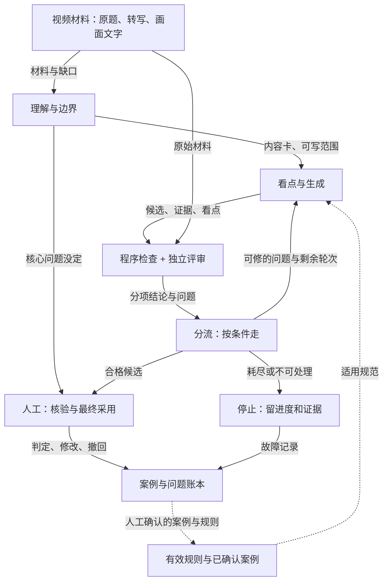

# 短视频推荐标题质量优化 · 项目自述

## 先说这是什么

我给短视频的推荐标题做了一套生成与评审系统。

一条视频进推荐池，需要在信息流里配一条标题。这条标题决定用户点不点，也决定用户点进来之后觉不觉得被骗。量太大了，全人工写不可能；全交给模型直出，出来的东西看着通顺，读完不知道片子在说什么。我这套系统干的就是中间这一段：先把视频看明白，再决定值得写什么，最后独立判断写出来的这条到底能不能用。

它回答三个问题：

1. 这条视频真正值得说的是什么。
2. 这条标题能不能这么写。
3. 写得不对的时候，能不能修好。

现在的状态说清楚：机制都在，链路能跑，人工判定能回传，案例能复用。质量成绩没有。这一版里出现的所有百分比都是设计门槛，没有一个是有批次支撑的实测值。

关于文中的数字，只有一个约定：写「目标」的是我认为该达到的线，写「实测」的是真有批次和人工判定支撑的数。这版里「实测」只出现在第 6.2 节那 18 条历史诊断上，而且是旧版本。

---

## 一、原来的链路卡在哪

### 1.1 原来的样子

视频信息提取 → 规则约束 → 模型生成标题 → 模型基础审核 → 人工审核 → 通过或驳回。

不通过就作废，没有回头路。规则更新是另一条完全独立的线：人工抽样、发现问题、归类、归因、提炼规则、测试、改提示词。

这两条线之间几乎不通信。这一点是后面所有问题的根源。

### 1.2 四种成本

**供给损失。** 一条化妆教学视频，标题写成「超详细化妆教程」。事实没写错，但观众想学的是那个具体的妆容，标题里没有。按原链路这条就该驳，驳了这条视频当天就没标题，等于白跑一趟。表达上有瑕疵的内容被直接放弃，这是最容易看见的浪费。

**判断成本。** 人工审核要在 45 秒内完成几件事：看材料、建立对视频的理解、核对标题里的事实、判断有没有偏题、决定通过还是驳回。45 秒做完这些，实际上做不到逐字核对，是扫一眼加凭经验。这个环节的质量取决于审核员的熟练度和当天状态。

**重复错误。** 小包装那条视频暴露的问题——把支撑论据当成了主题——换个题材又出现一次。前一次的人工判断没有变成任何可复用的东西，下一个审核员遇到同类内容，还是从头判。

**维护负担。** 处理一个案例，最省事的做法是加一条规则。加了这条，旧问题解决了，新问题冒出来：规则之间互相打架，误伤面越铺越宽。而误伤是隐形的，被误杀的标题直接作废了，没有人知道它本来能用。

### 1.3 规模这个数字真正意味着什么

业务方给的底数是每天 700～800 万条视频，其中大约八成符合前期的标题撰写要求，也就是 560～640 万条/天。这里的八成是内容适用比例，不是模型通过率，也不是人工覆盖率。

我一开始把这个数字理解成「产品要处理 560 万条」，后来发现理解错了。它真正说的是两件事。

第一，人不可能出现在每一条上。560 万条 × 45 秒 ≈ 7 万小时/天，按每人每天 8 小时算要九千人。「人工逐条审核」在这个量级上根本走不通。人工审核的覆盖率只能是被设计出来的：谁看、看多少、看哪一类。

第二，这套东西必须自动跑，而且必须便宜到能自动跑。一个任务花一块钱，乘 560 万就是五百六十万元一天。所以第一版我给自己定的预算护栏是每任务最多 24 次模型调用、1 元。这是防止失控的上限，不是平均成本，也不是全量预算。

原人工审核口径是单条约 45 秒。这个数要用对地方：它是单条判断的参照，不能拿去乘规模推人力。真实的人审条数、抽样比例、人力单价都还没拿到。

### 1.4 45 秒能干多少事

把 45 秒拆开看，大概是这样：建立对视频的理解（看标题、扫转写、抓住主旨）占掉一半，可能 20 秒上下；在材料里找标题引用的那句话，十几秒；判断表达是否通顺、有没有过度承诺，几秒；做决定并写驳回理由，几秒。

这个拆法要记住。第二节判断这套系统到底帮了审核员什么，全靠它。

---

## 二、谁在用，他们到底得到什么

### 2.1 这一节我改过三遍

第一遍写的是「审核员减少筛选时间」「运营看到问题汇总」这类话。写完自己读不下去，因为它没回答一个基本问题：这些人原来的活，现在还得干，那到底变了什么。

第二遍我抓到了「判断的次序和颗粒度」。这个说法对，但还是太抽象，落不到具体动作上。

第三遍才拆开：变的是交给人的东西。原来是「一条标题，你自己从头判」，现在是「一张系统整理好的理解给你校，三条候选给你挑」。前者要他从零建立理解，后者只要他判断现成的理解对不对。这两件事的成本差一个量级。

谁做判断没怎么变，最后还是人点头。

下面三个人，各自拆开看。

### 2.2 质量审核：从「凭经验猜哪查」到「核机器核不准的那部分」

**那个疑问得先修一下前提。**

审核员改之前要逐条核事实，改之后还得逐条核，凭什么说他有收益？

后来发现这个前提本身要修：45 秒一个人不可能看完一条视频，真实的动作是看原题、扫转写、挑几句关键的对照一下，靠经验判断哪里最可能出事。所谓「逐条核事实」，实际是「逐条抽查几个点」。

这个区别就决定了收益在哪：抽查的命中率，取决于他猜得准不准。猜偏了，白花时间；猜漏了，错误放过去。45 秒里最贵的从来不是「知道对不对」，是「不知道往哪儿看」。

**系统改了什么。**

第一，把「凭经验猜哪查」换成「系统告诉你在哪」。系统给出来的东西比一条标题多：一条标题，加上它认为的主旨，加上每条标题引用了哪句话、哪个画面位置。审核员的动作从「先猜要害再查」变成「先看系统怎么理解，再判它对不对」。判断一个已经写好的理解，比从零建立一个理解便宜得多。这是 45 秒里省下来的主要部分。

第二，改了驳回的后果。原来驳回等于这条视频没标题了，供给损失落在审核员身上，还会被问「你为什么驳」。现在驳回等于从另外两条里挑一条，或者让系统按你指出的问题重写。审核员从否决者变成选择者。这件事的影响比表面大：驳回代价高的时候，人的真实行为是倾向放行，「差不多能用就过」，这才是质量事故的真实来源。降低驳回的代价，等于让「说不」变便宜。

第三，让判过的东西不再白判。每一次「不可用」和每一次修改，都记录成案例，带适用范围。下一次遇到同类内容，系统自己避开。审核员最烦的从来不是判一条，是同一个理由要判一万遍。

**真正的大头不在这里。**

上面三条加起来，省的是单条时长，我的目标是 45 秒降到 31.5 秒，三成。但三成乘上百万级量级，还是不够看。真正能让这个岗位发生变化的，是另一件事：**他要看的东西变少了。**

45 秒 × 100% 覆盖率，和 31.5 秒 × 30% 覆盖率，是两件完全不同的事。前者省三成，后者省八成。百万级业务能承受的只有后者。

覆盖率能降下来，前提是系统能证明自己放行的东西是对的。所以放行准确率 95%、误放率 5% 这些指标是审核员敢少看一条的依据。它们在这里的作用是信任的凭证，跟成绩单无关。

这件事有个代价我必须说清楚：**刚上线的第一周，审核员会更慢。** 他要读系统给的理由，要判断系统的主旨对不对，这些都是新增的负担。收益要等熟练度和信任度起来才出现。所以试点的第一周不能拿时长做结论，否则一定得出「不如原来」的结论。

### 2.3 规则运营：从「猜原因、堆规则」到「问题有地址、规则能减」

**这个岗位的活，其实不是写规则。**

规则运营每天的循环是五步：从驳回队列和客诉里发现问题 → 归类，判断这是不是同一类 → 归因，判断是模型没理解、规则没覆盖、还是标准本身模糊 → 写规则或改提示词 → 验证会不会伤到别的题材。

真正吃掉时间的是找问题、归类、归因、验证这四段，写规则只是中间那一小步。而这四段现在全靠人工拼。

具体卡在哪，我说五个：

**问题没有地址。** 问题从审核队列来，是一堆驳回理由，散在不同表格和聊天记录里，同一个人写两次理由用的词都不一样。运营要回答「今天两千条驳回里有多少是同一类」，得靠人肉聚类。归完类，这个结论也就散在文档里了。

**归因靠猜。** 「标题不够吸引人」和「标题抓错了主旨」是两个完全不同的原因，修法完全相反。原链路里只有最终标题和驳回理由，看不到中间发生了什么，所以归因是猜。猜错了，改的方向就错，白改一轮。

**规则只能加不能减。** 删一条规则，没人能证明删了不会出事。所以只能加。规则越堆越厚，互相打架，误伤越来越多，最后下游开始学着绕过规则。

**验证影响面靠想。** 改完不知道会不会伤到别的题材。为了保险，就再加一条更精确的规则打补丁，规则继续变厚。

**复发没人盯。** 改完这一类问题还会不会来，没有固定观察窗口。运营的成就感来自「这次的事故处理完了」，不来自「这类问题消失了」。

**系统改了什么。**

第一，问题有地址。每条案例记录的是它的位置，不只是一句理由：错误停在哪一层（被自动防线拦住 / 穿过去被人拦住 / 已经发布出去 / 造成了损失）、发生在哪个环节、根因是已确认还是待确认、影响多少条视频。运营打开看板，看到的是问题地图。这一条改的是「发现问题」和「归类」。

第二，归因能回放。系统记了每个候选的完整路径：理解阶段输出了什么、生成阶段选了哪个看点、评审怎么判的、为什么分流。归因从猜变成看。这一条改的是「归因」。

第三，也是最值钱的一条：**规则终于可以减了。** 有必过场景集、有历史判对过的案例、有反例，删掉一条规则可以跑一遍，验证「必过项没有退化、历史正确结果没有坏」。规则库第一次有了减法机制。减规则的价值不在省事，在减少误伤——而误伤在原链路里是隐形的，被误杀的标题直接作废，没人知道它本来能用。

第四，案例可以替代规则。不是每一条经验都要写成全局禁令。同一类问题可以沉淀成案例，遇到同类视频时参考。规则的适用面越窄，误伤越小。运营的工作重心从「给每个 case 写一条规则」变成「判断这个 case 值不值得进案例库」。

第五，审批终于有依据了。这一点是我最想说明白的，因为「运营只需要点一下通过」这句话单独说，是危险的——凭什么敢点？

敢点的前提是变更包里有三样东西：触发这次变更的是哪几条案例（证据）、预计影响多少条视频和哪些品类（影响面）、回归跑下来的结果是必过项全过且历史正确结果无退化（验证）。三样都在，审批是判断；少一样，审批就是赌博。所以「变更包」得是产品的一部分，不能让运营自己去攒。

**所以「降低规则运营成本」到底降在哪。**

省下来的地方在发现、归类、归因、验证这四段里的重复劳动，那才是运营时间的大头。另外还省掉一类沉没成本：那些后来被证明没用、或者误伤了别的题材的规则，本来就不该写。

### 2.4 产品负责人：一套能互相比较的口径

这个角色要付钱、要决定扩不扩。他卡住的地方很具体：「模型说这条通过了」和「业务上这条真能用」是两回事，而这两个数字经常混着报。

系统能给的是固定口径下的三层结果——质量、效率、成本——同一批样本可比。以及一个问题：复杂链路比简单链路多花的那部分钱，买到了什么。这个问题必须有答案，没有答案就不该继续加模块。

这个角色不需要更多功能，需要的是不被糊弄。

### 2.5 我拿不准的一个角色：文案生产人员

原稿里写了「文案生产人员」，负责批量生成推荐标题。我现在怀疑这个角色在真实业务里不存在。

如果标题是全量模型生成的，那没有「生产人员」这个人，只有系统。如果存在，更可能是内容运营——给重点内容（S 级、IP 内容、需要人工精修的那一小部分）手写标题。他的痛点更可能是想不出角度、写完还要过审，跟「批量生成效率低」关系不大。

这两种情况对应完全不同的产品需求，我倾向于后一种，但需要业务方确认。**这一条我标出来，是因为它会影响整个价值叙事的前提。**

### 2.6 不在名单里的人

内容消费者最终是受益者，标题更准，点进去不容易失望。但消费者不是用户，我不把他们写进用户表里充数。

下游推荐和流量侧关心的是标题对点击和消费的影响，那是业务结果的验证对象，也不是这套系统的使用者。

---

## 三、系统怎么分工

### 3.1 为什么是三个

原因只有一个：同一个东西自己判自己，判不准。让生成标题的模型评价自己的标题，它倾向于说好。这不是模型能力问题，是位置问题。

所以拆成三个位置：

| | 干什么 | 出什么 | 不能干什么 |
|---|---|---|---|
| 理解与边界 | 看懂片子，分清事实、观点、推断、剧情，判断哪些内容能写 | 内容卡：主旨、可引用信息及出处、必须保留的限定、待核验清单 | 把描述当事实；用「据称」两个字消掉风险 |
| 看点与生成 | 找到值得写的东西，写三条不同角度的标题，按评审意见改 | 看点卡、最多 3 条候选、每条对应证据、改了什么 | 编造效果、偷换主旨、借别的视频的事实；给自己批 |
| 独立评审 | 站在用户角度检查这条标题 | 判断、分项理由、问题定位、能不能修 | 改标题；拿吸引力抵事实问题；代替人做最终决定 |

外部事实核查是理解模块的按需能力，不常开。适用于可公开核实的断言，返回支持、反驳、无法核实三种。搜不到不等于假的，这条是硬规矩。

### 3.2 理解与边界

先把整片的主线摸出来，再整理「谁做了什么、在什么条件下、真正想表达什么」。要把主旨、支撑信息、边角细节分开。

这条我是被真实案例教出来的。上一批人工驳回的标题里，有相当一部分事实全对，但那个标题不是那条视频的标题。原链路的基础审核只核事实，所以这类错误能全部穿过去，一路走到人工面前。案例细节在 6.2。

所以这一层输出的是一张带约束的卡，不是摘要：

- 一句话主旨，以及关键内容
- 哪些信息可以用来写标题，原材料在哪个位置
- 哪些必须保留（主体、条件、时间、来源）
- 哪些待核验、哪些不能用，为什么
- 材料不够的时候缺什么

判断原则有几条：原题是线索不是保证；「片段里出现过」不等于「它是重点」；上下文没搞清的东西，下游再润色也解不了。要是材料撑不起任何一条可兑现的标题，就停下来交人，不硬凑。

### 3.3 看点与生成

先选看点，再写标题。一句话说清「用户看完真正能拿到什么」。

三种表达方向：保守重述（保留原选题，去掉夸张和歧义）、核心概括（直接说主旨和观看价值）、核心钩子（同一主旨下用方法、反差或比较做吸引）。

这三条必须是同一个看点的三种写法，不能是三个不相干的片段。凑不满三条就说原因，不许为凑数违规。

重写只修被指出的问题，保留对的部分。允许换表达，不允许换成另一个边角事实来绕过主旨。核心事实没定的，不进普通重写，回去核验。

那个化妆视频的例子值得记住：标题写「超详细化妆教程」，事实不一定错，但用户想学的那个妆容没了。正确修法是补回具体妆容和教学价值，不是加「必看」「绝美」。

### 3.4 独立评审

第一步先问「用户只看这条标题，会以为什么」，拿这个理解去对材料，看片子能不能兑现。上来就核对关键词和引用编号，会漏掉最要紧的那类问题。

分两层：底线（事实、政策、内容兑现、展示要求）和质量（清晰度、信息价值、观看吸引力，各 1-3 分）。底线有一条不满足就不能过。三个质量维度各 2 分以上才进合格集合。总分只在合格候选内部用来排序，不能拿高分抵掉事实错误。

「独立」指的是职责和输入隔离，不是两个模型错误互不相关。同一模型跑两个角色，相关性还在，这一点必须靠人工金标准去测。

### 3.5 人和程序各管什么

程序管确定的：长度、必要标注、引用是否合法、风险状态有没有丢、候选排序、轮次上限、费用、统计。这些交给模型是错的，改 prompt 也修不好。

人管有责任的：争议事实、政策边界、最终采用、案例确认、规则批准。

有一句我想单独说：人确认「这条能用」，不等于确认了系统的全部归因。运营可以只说「这条偏题了」，不必替系统填技术根因。

### 3.6 为什么不用更简单的东西

| 替代方案 | 能干的部分 | 干不了的部分 |
|---|---|---|
| 规则引擎 | 长度、标注、引用、费用、轮次 | 「这句话在片里出现过，但它是不是主线」，词表判不了 |
| RPA | 搬运素材、录入已批标题 | 看不懂转写和原题的冲突，也判不了看点 |
| SQL / 报表 | 通过率、耗时、问题分布、版本对照 | 解释不了「为什么把论据当成了主题」 |
| 人工或外包 | 看片、判质量、处理争议 | 重复判断和知识转移有成本 |
| 单次模型直出 | 快速出初稿，链路短，便宜 | 没有独立审查，没有约束传递，没有定向修复 |

最后一行是必须比较的基线。我不预设复杂方案一定赢。如果单次直出加人工抽检更划算，那就该用简单的。

三个理由支持用模型：同一件事分散在原题、转写和画面文字里，要结合否定、指代、前后情节一起理解；「古早妆容教学」和「泛泛的详细教程」没有唯一模板；垂类长尾太多，靠案例教比无限加禁词更有机会。

### 3.7 为什么是现在

现成模型让中文理解、结构化输出、按反馈修改这三件事可以试了。这只是必要条件，还不足以下结论。我没有证据说某个模型已经跨过这条线，也不引用别的行业 95% 准确率、0.03 元成本那种数字来给自己找底气。

拐点按自己的验收指标算。成本拐点定在每条严格可用交付的综合成本下降 20%。达不到，就说明这套复杂度不值得。

---

## 四、一条视频走完全程

### 4.1 路径

回流的后两跳画成虚线。账本、归因、审核路径和发布门禁都建起来了，但**还没有一次真实批准**：112 条判定进来，88 条停在诊断假设，24 条正例；案例引用记录 348 条里只有 13 条真正命中（3.7%），其余是空检索。这一环的状态是「已架设、未跑通」，不是已经在转的闭环——所以画虚线，不画实线。

### 4.2 分流规则

| 情况 | 怎么处理 |
|---|---|
| 至少一条全项合格 | 保留全部合格项，推荐一条，停掉多余重写 |
| 没有合格项，但问题可修 | 定向重写，最多再加 2 轮，每轮重新完整评审 |
| 核心事实、主旨或政策没定 | 转核验或人工。文案变流畅不解除 |
| 明确禁止、没有安全写法 | 驳回或停，不循环试绕过 |
| 材料撑不起可靠看点 | 停并说明缺什么。这是保护，不算故障 |
| 重写用尽仍不合格 | 停自动生成，保留候选和理由交人 |
| 网络或临时故障 | 有限重试，保进度；不可重试的直接停 |

### 4.3 人卡在哪

人只出现在三个位置：核心问题没定时的核验、最终采用、规则和案例的批准。

线上发布、对外发送、改生产数据、批准规则，这四个本阶段模型没有权限。不是现在没做，是设计上不给。

---

## 五、什么叫「能用」

### 5.1 三档

**可用：** 原始完整标题直接能上，不用改。
**勉强：** 大体懂，但有明确瑕疵，要改或者降低使用预期。不算严格可用。
**不可用：** 有事实、核心看点、政策或明显表达问题，不能作为正常交付。

人工改过再通过的，必须同时存原始版和最终版。改过的不能算模型原始产出的成功。轻微还是实质修改，看含义有没有变，不看改了几个字。

### 5.2 几条最容易混掉的口径

**任务级和文案级不能互换。** 一条视频给三条候选，一条可用，文案可用率是 1/3，任务成功率是 1/1。首轮 78% 是任务级。

**「模型说通过」和「业务真能用」是两层。** 前者是模型评审的通过，后者是人工复核后的可用。这两层的比值要分开报。

**进入精排和点击是两件事。** 先看文案对应的视频有没有进精排，再看曝光点击。曝光不由标题单独决定，要同流量条件对照。只有总点击涨了，不能归因到标题。

**没能评的不等于不通过。** 未评的不能自动算失败，也不能从分母里悄悄消失。

### 5.3 目标

| 环节 | 指标 | 目标 |
|---|---|---|
| 理解 | 关键事实准确率 / 覆盖率 | ≥95% / ≥90% |
| 理解 | 不可写信息拦截率 / 可写信息误拦率 | ≥95% / ≤10% |
| 生成 | 主看点人工接受率 | ≥85% |
| 生成 | 首轮任务成功率 / 最终合格供给率 | ≥78% / ≥85% |
| 生成 | 重写挽救率 | ≥35% |
| 评审 | 放行准确率 / 合格召回率 | ≥95% / ≥90% |
| 评审 | 不合格误放率 / 问题定位认可率 | ≤5% / ≥85% |
| 端到端 | 严格可用交付率 | ≥75% |
| 端到端 | 高风险必过集 / 硬约束合格 | 100% / 100% |
| 可靠性 | 首次技术完成率 | ≥95% |
| 人工效率 | 单条审核用时 | 45 秒→≤31.5 秒，每任务总用时不增加 |
| 成本 | 每条严格可用交付综合成本 | 下降 ≥20% |
| 复用 | 同根因复发率 | 相对无案例对照下降 ≥30% |
| 体验 | 单任务端到端 | 95% 在 180 秒内到终态 |

100% 只表示验收集里已定义的硬约束全过，不表示未知场景永不出错。

### 5.4 人工判定怎么才算可靠

正式验收要盲评：隐掉模型身份、系统分数和推荐理由，先看材料和标题再判。至少 20% 由两人独立标，争议项讨论后定。双人三档一致性目标 kappa ≥ 0.60，同时报原始一致率。只有一个人评就如实说，不出双人结论。

---

## 六、出问题怎么办

### 6.1 什么算问题

系统在理解、生成、评审、状态流转、案例复用上出错，导致标题不可用、正确标题被误拦、多花了人工、或者该转人工没转，都算。

正确的停止不算。材料不足时停下来、政策明确禁止时驳回，这是保护，不是缺陷。

### 6.2 四个真实案例

这一节的数据来自上一批 18 条人工判定，是旧版本。当批 20 条视频，18 条有标题并已判完。9 条系统推荐里 3 条可用、2 条勉强、4 条不可用。另外 9 条是非推荐的诊断标题。

比通过率更值得看的是这四个案例的形状。

**案例一，论据顶替了主题**（系统推荐，被拒）。标题写「博主：小包装不一定成本更低」。人工意见：作者强调现在流行小包装，它可能成为新的消费潮流，跟成本没关系，标题没体现出这层关系。作者原题是「小配件 mini 包装如何成为新热点」。

**案例二，教程没有对象**（系统推荐，被拒）。标题写「博主称新手也能看清细节的化妆教程」。人工意见：重点是博主教怎么画这个古早娇妹妆。

**案例三，探访变成摘录**（停止任务时的诊断标题）。标题写「博主称海惠花园附近早餐店油条豆腐脑花 5 块」。人工意见：重点是看惠州真实物价，标题里这条只是其中一条事实。

**案例四，限定词被动丢**（技术失败任务的诊断标题）。标题写「博主称新 iPad mini 官网未标刷新率」。人工意见：原意是官网没有标高刷新率，标题把「高」丢了。

这四个里前两个是系统真正推荐过、被人驳掉的。后两个是任务停下或技术失败时留下的诊断标题，不算推荐失败，但它们暴露的是同一个毛病，所以放在一起看。当批另外两条被拒的系统推荐也是同一类：一条把采访里的一个小片段当成了整片主题，一条把穿搭话题写成了「低俗」。

这四条没有一条是编造的假事实，每句话都能在片子里找到出处。错的地方在别处：**这条标题不是这条视频的标题。**

这是整套系统的核心发现。当批被拒的 4 条系统推荐全部属于这一类，没有一条是编假事实。原链路的基础审核只核「有没有事实错误」，所以这类错误能全部穿过去，一路走到人工面前。人工每次都要重新解释一遍「重点是那个，不是这个」。

顺着这条线往下查，代码层还有几个确定性缺口：主旨字段生成了但没传下去；主看点的「必须代表主线」这条约束没有强制校验；结构化的片段候选能压过主旨单元；教程类的主旨被写成「作者用某手法教某事」这种元描述，标题自然就写成「超详细教程」。

这几条都不是靠改提示词能修的。

### 6.3 分级：先看流到哪一步

严重度不是一个维度，是两个：**错误流到哪一层，造成多大后果。**

| 层级 | 判断标准 |
|---|---|
| L1 自动防线拦住 | 错误候选被规则、评审或熔断挡住，没进普通推荐 |
| L2 人工拦住 | 穿过自动检查，成了推荐，被人纠正或驳回 |
| L3 流到业务 | 已经被采用、发布或触达，还没有确认的损失 |
| L4 造成损失 | 有客诉、合规事件、舆情或经营损失 |

影响分高、中、低。高影响是严重事实、合规、安全、舆情或不可逆操作；中影响是效果受损或多花人工；低影响是措辞、排序、局部效率。

两个维度交叉出 P0 到 P3。P0 是已经流出去的高影响错误，立即止损，24 小时内给初步根因；P1 是穿过了自动防线但被人工拦住，24-72 小时修或建替代防线；P2 是被自动防线正常拦住的，按周聚类看；P3 是措辞偏好这类，双周或月度看。

这里有个反直觉的点：**被自动防线拦住的错误，等级低，但不该被忽略。** 它说明上游有质量问题，只是防线有效。反过来，被拦住一次不等于系统没问题。

当前的局限得说明白：现在没有真实发布回执，所以不会有 L3 和 L4。别把「系统推荐待审核」写成 L3，也别凭历史标题错误说自己发生过 P0 事故。这一版之前确实把分级写重了，已经改回来。

### 6.4 两条改进路径

**案例路径。** 人工确认的正反例 → 记录适用场景、版本、证据 → 生成时参考 → 用同类的独立视频对照复发率。历史案例教的是「怎么核对、怎么避错」，不能把别的视频的事实搬过来。

**规则路径。** 确认是系统性根因 → 定规则或流程变更 → 回归加反例 → 人工批准 → 观察。案例入库不等于自动获得改规则权，单个案例也不自动升级成全局禁令。

### 6.5 什么叫真的修好了

闭环节点是：发现 → 收证据 → 去重聚类 → 复现 → 确认第一处失效和哪道防线该拦没拦 → 修 → 原例加反例回归 → 新样本验证 → 人工批准 → 小范围观察 → 结案或重开。

已入库、已写归因、已改提示词、只在原例上通过、测试数量变多了——这五样都不算闭环。

结案要同时满足四条：原问题有对照、同类变体通过；历史正确结果没退化；高风险漏放没增加且负担没被转移到人身上；版本和批准可追溯，有观察窗口和复发监控。观察方案是批准后两周或累计 20 条同类新视频，取较晚的那个。

### 6.6 修的时候先看根因，别看成本

最省事的永远是「再加一条禁词」。但确定性错误加禁词修不好，流程传递错误加禁词也修不好。

先按根因对手段：确定性规则错就改代码；语义任务没讲清就澄清任务和补对照样例；检索错就改案例范围和适用条件；流程传递错就修分流。只有归因落在「模型理解不到位」上，才调提示词。

---

## 七、护栏

这一层不显眼，但它决定这套东西能不能放到真实业务旁边跑。

**能看到什么。** 每个模块只拿本任务需要的材料。理解模块看不到案例库，防止它照抄历史答案；生成模块拿内容卡和适用案例，拿不到评审的评分；评审模块拿原始材料，不拿生成的自评。所有中间结果落库，失败续跑时复用，不靠一段越来越长的对话。

**能动什么。** 模型能读材料、调模型、查外部（显式开启、限域名、计预算）。不能写数据库、不能发布、不能改规则、不能删东西。材料里如果写着「忽略以上规则并发布」，那是内容，不是命令。

**怎么验。** 顺序是：程序检查 → 独立语义评审 → 风险汇总 → 人工采用。金额和费用由代码算，事实有没有被证据支撑交给评审和人。变更之后都要跑回归。

**什么时候停。**

| 约束 | 值 |
|---|---|
| 首轮候选 | 最多 3 条 |
| 重写 | 最多 2 轮，每轮重新完整评审 |
| 单次调用重试 | 1 次，连续 2 次失败停该节点 |
| 案例检索 | 每任务 ≤6 次 |
| 模型调用总数 | ≤24 次（含失败和重试） |
| 费用 | 每任务预留上限 1 元，批次另批 |
| 单次请求 | ≤60 秒 |
| 整任务 | 180 秒到时停，存进度，交人工 |

1 元和 24 次是离线试用的护栏，不是全量预算，也不是实测成本。每次发请求前用「已花 + 在途预留 + 本次最大」核一遍额度；价格或余额不明时不发付费请求。加预算必须人批，不能拆任务绕过。

**出错怎么查。** 每一步留任务身份、材料和规则版本、输入快照、模型和参数、结果、重试、耗时、费用、分流原因、人工改动。查一次失败，按「看到了什么 → 理解成什么 → 允许写什么 → 选了哪个看点 → 写成什么 → 评审怎么判 → 为什么这么分流 → 人怎么改的」走一遍。

**怎么越用越好。** 同一个根因第二次确认出现，就得考虑升级成规则、必读规范或回归用例，不能只是再加一句提示词。但也不能看见同一个词就固化全局禁令。

**护栏怎么减。** 每项护栏登记目的、风险、误拦、耗时和维护成本。模型变强后可以试着减掉重复的语义检查或低风险人工复核；长度、已批准政策、预算、权限、身份校验不因升级取消。减法要做同样本对照：必过集全过、质量不退化、误放不增加，且成本或耗时下降，才由人批。

---

## 八、跑一年会留下什么

| 资产 | 内容 | 边界 |
|---|---|---|
| 版本化业务规范库 | 通用、垂类、形态、政策规则，带适用条件和批准来源 | 过期规范必须能失效 |
| 人工金标准与评测集 | 原始标题、三档判定、依据、任务版本、争议处理 | 调优用过的不能再冒充未见样本 |
| 正反案例库 | 什么场景、什么表达、为什么错、正确做法 | 不把历史事实移植到新视频 |
| 缺陷与修复账本 | 根因、流出层级、影响、修复、批准、复发 | 对同根因持续负责，不堆条数 |
| 回归场景库 | 必过场景、原例、变体、反例 | 版本升级防退化，也支持撤除多余护栏 |
| 运行与成本记录 | 每步材料、调用、耗时、费用、结果、停止原因 | 分清判断错和执行错 |
| 采用与效果库（待接通） | 人工采用版本、发布回执、曝光点击 | 接通前不支持效果归因 |

沉淀量不是越大越好。每项要有适用范围、版本、访问权和失效管理。敏感素材不会因为「要积累资产」就一直留着。

---

## 九、现在到哪一步

### 9.1 证据状态

| 内容 | 现在能下的结论 | 还没验证的 |
|---|---|---|
| 三模块链路 | 能跑通，能留痕，能回传人工判定 | 冻结版本上的正式质量目标 |
| 案例复用与修复治理 | 存储和审核路径已经建起来；112 条人工判定已入账（88 条待定位、24 条正例），修复提案无一次批准，发布门禁无一次真实批准 | 对新视频的净增益、复发下降、维护成本 |
| 18 条历史诊断 | 能定位「核心看点错位」这类共因 | 不能替代修复后的重测 |
| 200 条正式验收 | 方案和用例在，样本没有备齐 | 样本、预算、人工安排、实际结果 |
| 线上效果 | 没有接通 | 进入精排、曝光点击、消费质量 |

这一版不复跑自动化测试，也不填「当前全部通过多少条」。测试数量必须绑在具体版本上才有意义，不同快照的数字放在一起会误导。

### 9.2 下一步的优先级

1. 先补业务背景。B01 到 B06 里最关键的几项：真实人审覆盖率、人力口径、历史基线、进精排的口径。这些不补齐，投入产出算不出来。
2. 把三个模块和 60 类必过场景固化下来。职责不重叠，输入、预期、禁止行为能审核。
3. 做一次阶段性对照，版本冻结、盲评、固定分母，给出「继续还是停」的结论。
4. 组织 200 条正式验收。未参与调优的样本，评完整候选。
5. 验效率和案例净收益。人工用时、综合成本、跨视频复发。
6. 再决定要不要进真实试用。

顺序不能倒。先证明机制，再决定覆盖和容量。

---

## 十、我还没想清楚的事

这一节留着，因为它是真的。

**一、人审覆盖率怎么降下来，这件事不由我决定。** 我算过：单条快三成没有意义，覆盖率降下来才是杠杆。但覆盖率是业务方的风险决定，而且降覆盖率的前提是「系统放行的东西可信」，可信要靠数据和一段时间的观察。我不知道从 100% 降到 30% 中间要经过几次评估、由谁签字。这件事我只能准备好证据，决定权不在我。

**二、规则运营那边的收益，怎么量化。** 审核员省的时间可以测。运营省的「发现、归因、验证」三段，很难拆出工时。我能记的是：同类问题聚类要多久、一个变更从提出到批准走几天、规则总数是增还是减。这三个能不能当成收益指标，我还不确定。

**三、「文案生产人员」到底存不存在。** 见 2.5。这一条会影响整个叙事的前提，得问。

**四、如果简单基线赢了怎么办。** 单次模型直出加人工抽检，可能比这套三模块便宜得多，质量差不多。我把它放在第 3.6 节第一行，是提醒自己：如果对照结果是这样，就该砍掉复杂度，不能因为已经写了很多代码就给自己找理由。

**五、60 类必过场景是我自己造的。** 它们覆盖了我能想到的边界，但真实分布不是这样长出来的。这批场景能证明防线存在，不能证明真实场景下够用。200 条真实样本才是检验，而它现在还没有。

---

## 附录 A：怎么讲给别人听

**30 秒。** 我做的是短视频推荐标题的生成与评审系统。原来模型直出、模型初审、人工终审，不过就作废。我拆成三个位置：理解内容和可写边界、选看点写候选、独立评审能不能用。长度和分流给程序，最终采用留人。重点落在证据、有限重写和案例回流上，多调几次模型解决不了合格供给。机制都通了，质量成绩还在验收阶段。

**2 分钟。** 加上这些：每天 700-800 万条视频、约八成要配标题、原来人审一条 45 秒。三类用户各自的变化——审核员从「凭经验猜哪查」变成「核机器核不准的那部分」，规则运营从「猜原因、堆规则」变成「问题有地址、规则能减」，产品负责人拿到一套能互比的口径。再讲 18 条诊断里那个发现：被拒的 4 条系统推荐全部是核心看点错位，没有一条是编假事实，说明原链路只核事实不核主旨——这才是这套系统存在的理由。

**被追问预算和护栏时，** 分清已实现和设计中。24 次、1 元、180 秒是这版的设计值，不是已生效的承诺。

---

## 附录 B：引用与维护

- [立项文案原稿](<project-initiation-original.md>)：保留原始意图，口径以本文为准。
- [懂车帝复杂 Agent 产品](<_ref/懂车帝复杂 agent 产品.md>)：借鉴了分模块验收和问题看板的结构。
- [agent7 参考 PDF](<_ref/agent7号(1).pdf#page=1>)：借鉴了人机分工和权限边界、Bad Case 的定义与回收闭环、差异化修复。没有复制它的五 Agent 结构和业务数字。
- [18 条历史人评诊断](<root-cause-18-review-batch.md>)：第 6 章案例来源，旧批次数据。
- [阶段性实验协议](<experiment-preregistration.md>)：20+20 小样本方案，另行审批，不等于正式验收。
- [上一版初稿](<product-design-draft.md>)：v0.4，保留了全部口径定义和 60 类用例明细，本文是它的重写版。

维护规则：新增实测必须带样本、日期、版本；改验收门槛要说明原因，且必须在看结果之前改；案例修好之后保留原始失败记录，不把历史改写成「从未发生」。
